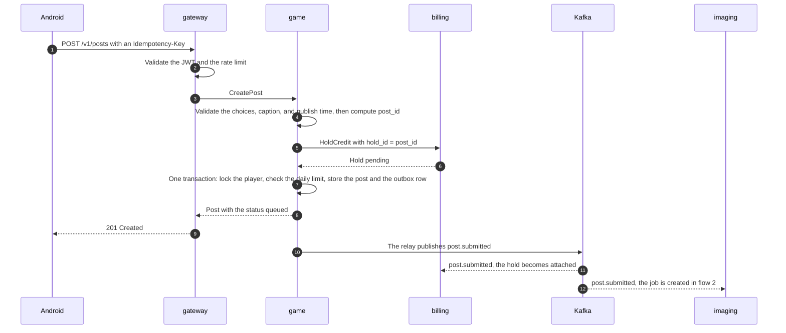

# Flow 1: creating a post

From tapping "post" in the app until the post has the status `queued` and its credit is held. References: [design §9](../system-design.md#9-photo-pipeline), [design §18](../system-design.md#18-billing-and-monetization), [ADR-0011](../adr/0011-credit-holds-authorize-capture-void.md), and the [`game_service.proto`](../../proto/ivo/game/v1/game_service.proto) and [`billing_service.proto`](../../proto/ivo/billing/v1/billing_service.proto) contracts.



## Request and response

```http
POST /v1/posts
Authorization: Bearer <access token>
Idempotency-Key: 0193a1f2-7c4e-7b2a-9d1e-5f6a7b8c9d0e
Content-Type: application/json

{
  "destination_id": "id-jakarta-kota-tua",
  "outfit_id": "casual-denim",
  "pose_id": "standing-wave",
  "expression_id": "smile",
  "caption": "Afternoon at Kota Tua!",
  "requested_publish_at": "2026-11-09T12:30:00Z",
  "express": false
}
```

```http
HTTP/1.1 201 Created
Content-Type: application/json

{
  "post_id": "4f1c2d7e-9a55-5b0e-8c3d-2e6f8a9b1c0d",
  "status": "queued",
  "credit_cost": 10,
  "estimated_ready_at": "2026-11-09T12:10:00Z",
  "requested_publish_at": "2026-11-09T12:30:00Z"
}
```

The `credit_cost` above is only an example; prices are set once the cost per post has been measured. If the same Idempotency-Key is sent again with the same body, the response contains the existing post with status 200.

## Steps in game

1. **Validation.** The destination must already be unlocked for the player, meaning the player's followers have reached the destination's threshold. The outfit, pose, and expression must exist in the catalog; cosmetic items must also exist in the entitlement copy. The caption is at most 280 characters and must pass the blocklist. `requested_publish_at` can't be earlier than the estimated photo completion and is at most 24 hours ahead.
2. **Compute `post_id`** = UUIDv5(`NS_POST`, `player_id:idempotency_key`). If a post with that ID already exists:
   - Same `request_hash`: return the existing post (`replayed = true`) without calling billing again.
   - Different `request_hash`: reject with `INVALID_ARGUMENT` and the reason `IDEMPOTENCY_KEY_REUSED` (HTTP 422).

   `request_hash` is the SHA-256 of the normalized request body.
3. **Compute the cost.** `credit_cost` = the base photo cost, plus the express fee if the player has no active subscription.
4. **Hold the credit** with `billing.HoldCredit(hold_id = post_id, amount = credit_cost, ref_type = POST)`. An insufficient balance is returned as `FAILED_PRECONDITION` with the reason `INSUFFICIENT_CREDIT` (HTTP 409), and no post is created.
5. **Store everything in one transaction.** The daily limit is checked again inside the transaction with a lock on the player row, so two concurrent requests can't both get through:

   ```sql
   BEGIN;
   SELECT 1 FROM game.players WHERE player_id = $1 FOR UPDATE;
   SELECT count(*) FROM game.posts
    WHERE player_id = $1 AND date_wib = $2 AND status <> 'failed';
   -- If the limit is already reached: ROLLBACK, VoidHold, then 409 DAILY_LIMIT.
   INSERT INTO game.posts (...) VALUES (...);
   INSERT INTO game.outbox (event_id, topic, message_key, event_type, payload,
                            player_id, occurred_at, available_at)
   VALUES ($event_id, 'post.submitted', $player_id, 'ivo.post.submitted.v1',
           $payload, $player_id, $now, $now);
   COMMIT;
   ```

   Posts rejected for NSFW still count toward the daily limit. Only posts that are `failed` because of a technical problem don't count.
6. **If the transaction fails** for any reason, game calls `VoidHold(hold_id, reason)` before returning the error. If game crashes before it can, billing's sweeper voids that hold after 30 minutes.

## Contents of `post.submitted`

| Field | Contents |
|---|---|
| `post_id`, `player_id`, `hold_id` | `hold_id` equals `post_id` |
| `credit_cost` | The amount held |
| `variant` | 0 for a new post |
| `lane` | `BATCH` or `EXPRESS` |
| `choice` | The idol, outfit, pose, and expression IDs; the idol's appearance tags; the destination's local time at the publish time |
| `background` | The chosen Mapillary photo: `s3_key`, placement anchor, and attribution |

The caption is not part of any event. Services that need it read it over gRPC, so the caption is never stored in Kafka, a DLQ, or BigQuery.

## Failures

| Event | Result | Handling |
|---|---|---|
| Insufficient balance | `HoldCredit` fails | 409 `INSUFFICIENT_CREDIT`, no post |
| The daily limit is reached during the transaction | The transaction is rolled back | game calls `VoidHold`, then 409 `DAILY_LIMIT` |
| game crashes after `HoldCredit`, before the commit | A `pending` hold without a post | A retry with the same Idempotency-Key reuses the same `post_id` and hold. Without a retry, the sweeper voids the hold after 30 minutes |
| An Idempotency-Key is reused with a different body | — | 422 `IDEMPOTENCY_KEY_REUSED` |
| billing is unreachable | `HoldCredit` times out | 503; the app may retry with the same Idempotency-Key |
| The outbox relay is late | `post.submitted` is published late | Visible in the outbox delay metric; the data stays correct |
| billing falls more than 30 minutes behind | The `pending` hold was voided before it was attached | billing tries to hold again. If that fails, billing publishes `credit.hold.failed` |

## Tests

- **Unit:** choice validation, cost calculation, and the deterministic `post_id`.
- **Integration (Testcontainers):** two concurrent `CreatePost` calls when only one post is left under the daily limit. The result is exactly one post, and the other hold is voided.
- **Integration:** game is killed after `HoldCredit`. A retry with the same Idempotency-Key doesn't create a second hold.
- **Contract:** `buf breaking` against `proto/` on the `main` branch.
