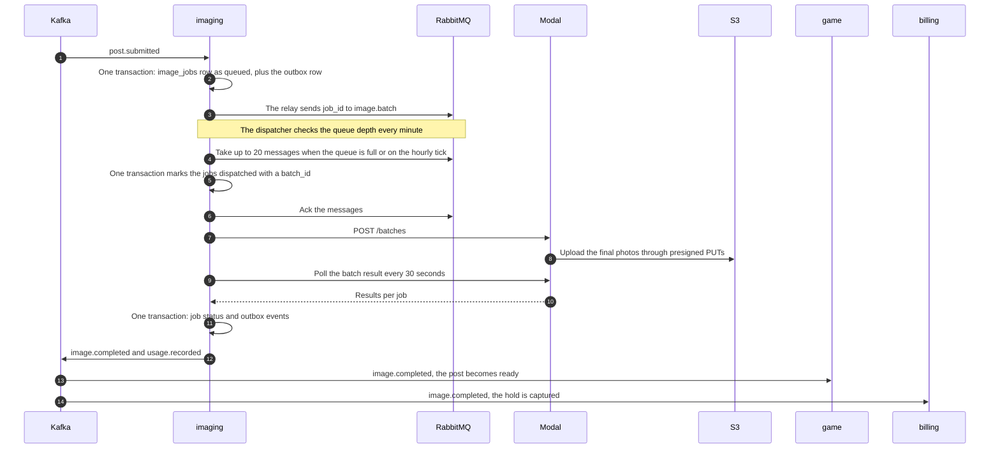

# Flow 2: photo session

From `post.submitted` until the post is `ready` and `post.published` is waiting in the outbox for its publish time. References: [design §9](../system-design.md#9-photo-pipeline), [design §11](../system-design.md#11-nsfw-moderation), [ADR-0003](../adr/0003-gpu-on-modal-with-hourly-batches.md), [ADR-0014](../adr/0014-image-jobs-in-postgres.md), and the [`imaging/v1/events.proto`](../../proto/ivo/imaging/v1/events.proto) and [`imaging/v1/gpu.proto`](../../proto/ivo/imaging/v1/gpu.proto) contracts.



## 1. imaging receives `post.submitted`

```sql
BEGIN;
INSERT INTO imaging.processed_events (consumer, event_id, processed_at)
VALUES ('imaging.post.submitted', $ce_id, $now);
-- A conflict here means the event was already processed: ROLLBACK, then commit the offset.
INSERT INTO imaging.image_jobs (job_id, post_id, player_id, hold_id, variant, lane,
                                status, render_spec, created_at)
VALUES ($job_id, $post_id, $player_id, $hold_id, $variant, $lane,
        'queued', $render_spec, $now)
ON CONFLICT (post_id, variant) DO NOTHING;
INSERT INTO imaging.outbox (event_id, destination, topic, message_key, event_type,
                            payload, player_id, occurred_at, available_at)
VALUES ($msg_id, 'rabbitmq', 'batch', $job_id, 'ivo.image.job.v1',
        $job_message, $player_id, $now, $now);
COMMIT;
```

The prompt builder assembles `render_spec` from `post.submitted`:

- Outfit, pose, and expression IDs are translated into tags through the `imaging.render_catalog` table. What an item means for gameplay belongs to game, while how it is rendered belongs to imaging.
- The idol's appearance tags, lighting tags from `local_publish_hour`, and safety tags in the negative prompt are added.
- The portrait resolution is 832 × 1216, one of the standard SDXL resolutions.

## 2. RabbitMQ topology

| Name | Type | Configuration |
|---|---|---|
| `image.jobs` | Direct exchange | Routing key `batch` or `express` |
| `image.batch` | Classic queue, durable | `x-max-priority: 5`; retried jobs come in with priority 5 |
| `image.express` | Classic queue, durable | — |
| `image.retry.batch` | Classic queue, durable | `x-message-ttl: 300000`, `x-dead-letter-exchange: image.jobs`, `x-dead-letter-routing-key: batch` |
| `image.retry.express` | Classic queue, durable | `x-message-ttl: 60000`, `x-dead-letter-exchange: image.jobs`, `x-dead-letter-routing-key: express` |

There is one retry queue per lane with a fixed `x-dead-letter-routing-key`. Without it, an expired message would carry the retry queue's name as its routing key, match no binding, and disappear without a trace.

## 3. Dispatcher

- **One leader.** Only one imaging replica runs the dispatcher: the one holding `pg_try_advisory_lock` on a dedicated connection. If that replica dies, its connection drops, the lock is released, and another replica takes over on the next tick.
- **Batch lane.** Every minute, the dispatcher reads the message count of `image.batch` through a passive declare, without taking any messages. When the count reaches 20, or the hourly tick has passed and the queue isn't empty, the dispatcher takes up to 20 messages with `basic.get`, then:

  ```sql
  BEGIN;
  INSERT INTO imaging.image_batches (batch_id, lane, status, job_count, started_at)
  VALUES ($batch_id, 'batch', 'running', $n, $now);
  UPDATE imaging.image_jobs
     SET status = 'dispatched', batch_id = $batch_id, dispatched_at = $now
   WHERE job_id = ANY($job_ids) AND status = 'queued'
  RETURNING job_id;
  COMMIT;
  ```

  Every message taken is acked after the commit, including duplicates whose job is no longer `queued`. If `RETURNING` is empty, Modal is not called.
- **The express lane** is consumed continuously with a prefetch of 1, using the same mark-then-ack pattern, one job per batch.
- **Circuit breaker.** After three consecutive failed batches, the dispatcher stops taking messages for 10 minutes. During that time jobs stay `queued` and don't use up their retries.

## 4. Calling Modal

The contract is HTTP JSON in the protojson format of [`gpu.proto`](../../proto/ivo/imaging/v1/gpu.proto). The Modal endpoint is protected by a secret token stored in Vault.

| Step | Request | Response |
|---|---|---|
| Submit a batch | `POST /batches` with a `RenderBatchRequest` | `202` and a `call_id`, stored in `image_batches.modal_call_id` |
| Fetch the result | `GET /batches/{call_id}` every 30 seconds | `202` while running, `200` with a `RenderBatchResult` when done |

- Every job carries three presigned URLs valid for 2 hours: a GET for the background photo, a PUT for the final photo (`posts/{post_id}/{job_id}.webp`), and a PUT for the review image (`review/{job_id}.webp`, SSE-KMS). The `image/webp` Content-Type is part of the signature.
- `batch_id` is used as the idempotency key, so resubmitting the same batch doesn't spawn a new GPU function.
- A batch that isn't done within 30 minutes counts as a technical failure for every job in it.
- **The watchdog** runs every 5 minutes and moves `dispatched` jobs older than 45 minutes back to `queued` if their batch is no longer `running`.

## 5. Inside the GPU worker

```text
for each job in the batch:
    for attempt = 0, 1, 2:
        seed = seed_from(job_id, attempt)
        image = render(Illustrious XL, render_spec, seed)   # 2-3 jobs per forward pass
        idol = birefnet(image)                              # alpha mask
        photo = composite(idol, background, anchor)         # foot point, scale, light direction
        tags, rating = wd_tagger(photo)
        if the explicit or questionable rating is high: try the next attempt
        if the sensitive rating is high: upload to review_put_url, result REVIEW, stop
        if segmentation finds explicit body parts: try the next attempt
        upload the WebP to output_put_url, result PASSED, stop
    if all three attempts were rejected: result REJECTED (only scores and hashes are recorded)
```

Rejected images are never uploaded. Every result carries `attempts`, `gpu_seconds`, the NSFW scores, the WD Tagger tags, and the file's SHA-256.

## 6. imaging processes the results

Every job is processed in its own transaction: the status update and the outbox events are written together.

| Result | Job status | Outgoing events | Notes |
|---|---|---|---|
| `PASSED` | `completed` | `image.completed`, `usage.recorded` | Carries the `s3_key`, the SHA-256, and the image tags |
| `REVIEW` | `review` | `image.review.requested`, `usage.recorded` | A `review_items` row with a 24-hour `expires_at` |
| `REJECTED` | `rejected` | `image.failed` (`NSFW_REJECTED`), `usage.recorded` | — |
| `ERROR`, retries < 3 | `queued` | — | `retry_count` goes up; the `job_id` is sent to `image.retry.batch` with priority 5 |
| `ERROR`, retries exhausted | `failed` | `image.failed` (`TECHNICAL`) | — |

## 7. game and billing react

**game receives `image.completed`:**

```sql
BEGIN;
INSERT INTO game.processed_events (consumer, event_id, processed_at)
VALUES ('game.image.completed', $ce_id, $now);
UPDATE game.posts
   SET status = 'ready', ready_at = $now, image_s3_key = $s3_key, image_tags = $tags,
       published_at = GREATEST(requested_publish_at, $now),
       rules_version = $rules_version, frozen_inputs = $frozen
 WHERE post_id = $post_id AND status IN ('queued', 'review');
INSERT INTO game.outbox (event_id, topic, message_key, event_type, payload,
                         player_id, occurred_at, available_at)
VALUES ($event_id, 'post.published', $post_id, 'ivo.post.published.v1', $payload,
        $player_id, $now, GREATEST($requested_publish_at, $now));
COMMIT;
```

`frozen_inputs` is computed right then and carried as is:

- `followers` at `published_at`, computed from the snapshot plus the events recorded so far. Posts scheduled out of order don't see each other's effects; this is accepted because it stays deterministic.
- `location_novelty_bp`, based on when the player last posted from the same destination.
- `frequency_penalty_bp`, based on how many posts went live in the 24 hours before `published_at`.
- `rules_version` from the active season.

**game receives `image.failed` or `image.review.requested`:** the post's status becomes `rejected` (`NSFW_REJECTED`, `REVIEW_REJECTED`, `REVIEW_EXPIRED`), `failed` (`TECHNICAL`, `HOLD_FAILED`), or `review`.

**billing** captures the hold when it receives `image.completed`, and voids the hold when it receives `image.failed`. Both are idempotent per (`hold_id`, generation, entry type).

## 8. Admin review

| Action | Effect in imaging | Event |
|---|---|---|
| Approve | The object is copied from `review/` to `posts/`, then the review object is deleted; the job becomes `completed` | `image.completed` |
| Reject | The review object is deleted; the job becomes `rejected` | `image.failed` (`REVIEW_REJECTED`) |
| 24 hours pass | A sweeper running every 10 minutes rejects it automatically | `image.failed` (`REVIEW_EXPIRED`) |

## Failures

| Event | Result | Handling |
|---|---|---|
| `post.submitted` is delivered twice | — | `processed_events` and the unique (`post_id`, `variant`) |
| imaging crashes after the commit, before the RabbitMQ ack | The message is redelivered | The job is already `dispatched`, so it is skipped and acked |
| imaging crashes after the ack, before calling Modal | The job is stuck in `dispatched` | The watchdog moves it back to `queued` after 45 minutes |
| Modal errors or times out | The batch fails | Delayed retries up to 3 times, then `image.failed` (`TECHNICAL`) and the hold is voided |
| Modal keeps failing | The queue piles up | A 10-minute circuit breaker and the "Modal fails often" alert |
| A presigned URL expires mid-batch | The upload fails | Treated as a technical error; new URLs are created on retry |
| `credit.hold.failed` arrives before the job is dispatched | The job must not be rendered | The job is marked `failed` (`HOLD_FAILED`) without calling Modal |

## Tests

- **Unit:** the prompt builder, mapping results to statuses, and computing `frozen_inputs`.
- **Integration (Testcontainers, Modal stubbed):** duplicate RabbitMQ messages never trigger duplicate renders, and a dispatcher killed at any point never loses a job.
- **Integration:** delayed retries go back to `image.batch` through the dead-letter exchange with priority 5.
- **Experiments:** hourly batches vs immediate, batch size, and cold start ([design §25](../system-design.md#25-experiments)).
