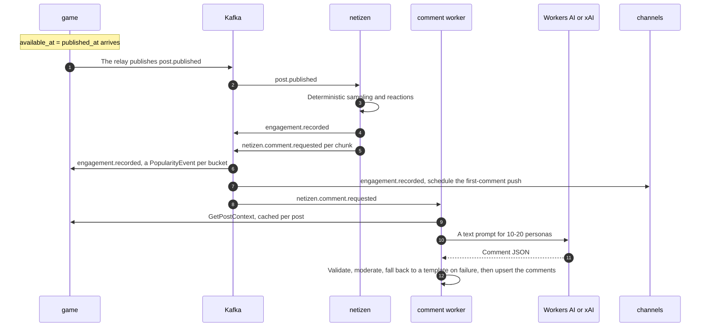
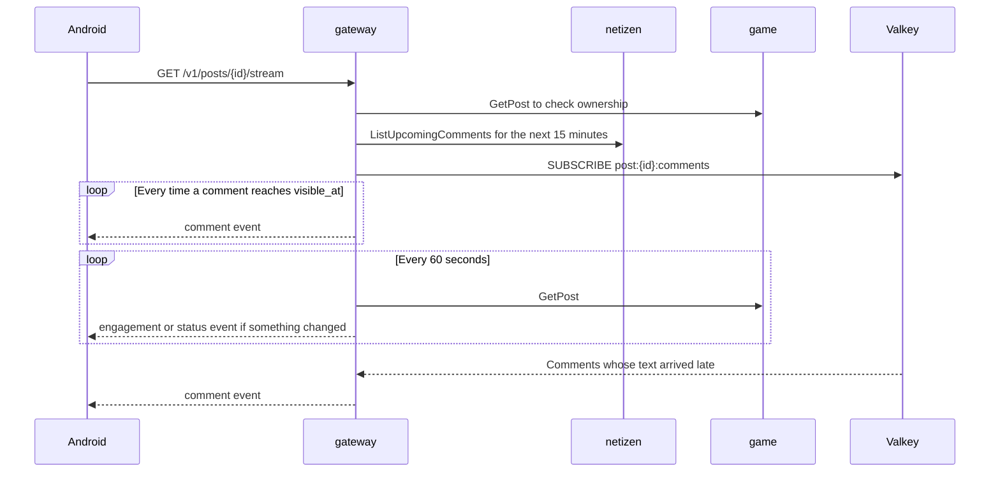

# Flow 3: publishing and reactions

From the publish time until likes, comments, followers, and pushes reach the player. References: [design §7](../system-design.md#7-time-model), [design §8](../system-design.md#8-popularity-engine), [design §10](../system-design.md#10-netizen-pipeline), [ADR-0012](../adr/0012-time-as-data.md), [ADR-0013](../adr/0013-deterministic-netizen-idempotency.md), and the [`netizen/v1/events.proto`](../../proto/ivo/netizen/v1/events.proto) and [`netizen/v1/netizen_service.proto`](../../proto/ivo/netizen/v1/netizen_service.proto) contracts.

## Write path



### 1. The post goes live

game's outbox relay publishes `post.published` as soon as `available_at` has passed. There is no other scheduler: the publish time is the `available_at` column.

### 2. netizen decides the reactions

The `netizen` consumer group processes every `post.published` as follows:

1. **Check `post_runs`.** If the status is already `reacted` or `commented`, the event is skipped and the offset committed. If it is still `reacting`, processing starts over from the beginning.
2. **Load the personas.** The 5,000 personas are kept in memory and reloaded when `persona_version` changes.
3. **Sampling and reactions.** All netizens are processed in `netizen_id` order. For each netizen:
   - a score is computed from how well their interests match (location and style) and how well their active hours match the publish time;
   - the score is turned into like and comment probabilities through a sigmoid, using the inputs frozen in the payload (`followers`, `location_novelty_bp`, `frequency_penalty_bp`);
   - `u(material, 0)` decides between ignore, like, and comment;
   - `u(material, 1)` sets the delay from `published_at`, which is then shifted into the netizen's active hours;
   - `u(material, 2)` decides whether the comment uses the true-character voice.

   The shape of the formula and its weights belong to `rules_version`, and the maximum delay is 4 hours.
4. **Engagement timeline.** Likes and comments are grouped into 15-minute buckets, then sent once through `engagement.recorded`, with `event_id` = UUIDv5(`NS_EVENT`, `engagement.recorded:post_id`). Every bucket carries an `effective_at`, the time of the last reaction in it. The bucket's numbers only apply from then on, so likes and comments are never counted before the reactions happen.
5. **Comment chunks.** Commenters are grouped by voice, sorted by `planned_at`, then split into groups of 15. Every chunk is sent as `netizen.comment.requested` with `event_id` = UUIDv5(`NS_EVENT`, `netizen.comment.requested:post_id:chunk_no`).
6. **Mark it done.** `post_runs` is created with the status `reacting` before step 4, so the comment workers always find it. After every event has been sent, its status changes to `reacted`, and then the offset is committed.

If netizen crashes between steps 4 and 6, reprocessing produces identical events with the same IDs, and consumers discard them through `processed_events`.

### 3. game records the engagement

```sql
BEGIN;
INSERT INTO game.processed_events (consumer, event_id, processed_at)
VALUES ('game.engagement.recorded', $ce_id, $now);
INSERT INTO game.popularity_events (player_id, season_id, post_id, kind, effective_at,
       likes, comments, delta_followers, delta_score, rules_version,
       source_event_id, recorded_at)
SELECT $player_id, s.season_id, $post_id, 'engagement', b.effective_at,
       b.likes, b.comments, b.delta_followers, b.delta_score, $rules_version,
       $ce_id, $now
FROM unnest($effective_at::timestamptz[], $likes::int[], $comments::int[],
            $delta_followers::bigint[], $delta_score::bigint[])
     AS b(effective_at, likes, comments, delta_followers, delta_score)
LEFT JOIN game.seasons s ON b.effective_at >= s.starts_at AND b.effective_at < s.ends_at
ON CONFLICT (source_event_id, effective_at) DO NOTHING;
COMMIT;
```

game computes `delta_followers` and `delta_score` with integer arithmetic from each bucket's likes and comments, using the weights of `rules_version`. For example, `delta_followers = (likes × w_like + comments × w_comment) × k_bp / 10,000`. Buckets that fall outside a season still add followers, but don't add to any season's score.

### 4. channels schedules pushes

When it receives `engagement.recorded`, channels writes `scheduled_pushes` with `ON CONFLICT DO NOTHING`:

| Kind | `send_at` |
|---|---|
| `first_comment` | `first_comment_at` from the event |
| `engagement_summary` | `published_at` + 3 hours |

The push sender runs every 30 seconds: it takes due rows with `FOR UPDATE SKIP LOCKED`, sends them to FCM, then sets `sent_at`. No pushes are sent between 22:00 and 07:00 WIB; a `send_at` in that window is moved to 07:00.

### 5. Comment workers

The `netizen-comment` consumer group, autoscaled by KEDA based on the lag of `netizen.comment.requested`. For every chunk:

1. **Skip what already exists.** A comment already stored for (`post_id`, `netizen_id`) is not created again.
2. **Pick a route:**

   | Condition | Route |
   |---|---|
   | True-character voice | xAI `grok-4.3`, immediately |
   | The earliest chunk (`chunk_no = 0`), Neurons allowance left, and a rate limiter token available | Cloudflare Workers AI, immediately |
   | Anything else | Stored in `comment_backlog` for the hourly Modal batch |
   | The daily budget is used up | A code template, immediately |

3. **Build the text prompt:** rules and policy, the context from `GetPostContext` (cached for 1 hour per post), the image tags, and then the list of personas. The output is requested as JSON `{"comments": [{"netizen_id": "...", "text": "..."}]}`.
4. **Validate:** the JSON matches the schema, every `netizen_id` belongs to the chunk, the text is 1–200 characters with no URLs or mentions, and it passes text moderation. Failures are retried once on the same route, then replaced by a template.
5. **Store** with an upsert per `comment_id`, with `visible_at` = the later of `planned_at` and now.
6. **Late comments.** If `visible_at` has already passed when the comment is written, the worker sends `PUBLISH post:{post_id}:comments` to Valkey so open SSE connections receive it right away.
7. **Record the cost** by publishing `usage.recorded` for every model call. netizen doesn't use an outbox, so the cost of one call can go unrecorded if the worker dies right after that call. Gaps like this show up when the numbers are reconciled with the provider's bill.

### 6. The hourly Modal comment batch

The netizen leader (chosen with a lease in Valkey) runs at minute 5 of every hour:

1. Takes up to 2,000 `pending` chunks from `comment_backlog` and marks them `running`.
2. Sends every prompt in one call to the vLLM function on Modal (Qwen 3.8 27B, 4-bit, L4).
3. Validates, moderates, and stores the results like steps 4–7 above, then marks the chunks `done`.
4. If Modal fails, the chunks go back to `pending` for the next hour. Chunks that have waited more than 3 hours are filled with templates, so every comment eventually appears.

A Valkey lease is enough for this task. If the lease is lost, the worst outcome is two leaders running at once and some chunks being processed twice, which is still safe because of the upsert per `comment_id`.

## Read path

| Data | Source | Rule |
|---|---|---|
| The post, likes, and comment count | `game.GetPost` | Likes and comments are summed from buckets with `effective_at <= now()` |
| The comment list | `netizen.ListComments` | Only `visible_at <= now()`, sorted by (`visible_at`, `comment_id`) |
| Followers and score | `game.GetPopularity` | The snapshot plus unfolded events with `effective_at <= now()` |
| Leaderboard | `game.GetLeaderboard` | The Valkey sorted set from the latest fold |

The comment count comes from the timeline, so it can differ slightly from the number of texts already visible:

- **Behind**, because a bucket's numbers only apply once its last reaction has happened.
- **Ahead**, when a text is generated late. Late texts catch up through SSE.

### SSE for the post screen



- The gateway sets a timer per connection for every upcoming comment, and refreshes that list every 10 minutes. Upcoming comments are never sent to the app before their `visible_at`.
- Every `comment` event carries the `comment_id` as its `id`. When the app reconnects it sends `Last-Event-ID`, and the gateway sends the missed comments through `ListComments`.
- While the app is in the background, the SSE connection is closed and the player relies on pushes from channels.

## Leaderboard fold

A job in game, run by the leader (advisory lock) every 5 minutes:

```sql
BEGIN;
WITH due AS (
    SELECT id FROM game.popularity_events
     WHERE folded_at IS NULL AND effective_at <= $now
     ORDER BY id
     LIMIT 5000
     FOR UPDATE SKIP LOCKED
), folded AS (
    UPDATE game.popularity_events e
       SET folded_at = $now
      FROM due
     WHERE e.id = due.id
    RETURNING e.player_id, e.season_id, e.delta_followers, e.delta_score
), followers AS (
    UPDATE game.follower_snapshots f
       SET followers = GREATEST(f.followers + d.delta, 0), as_of = $now
      FROM (SELECT player_id, sum(delta_followers) AS delta
              FROM folded GROUP BY player_id) d
     WHERE f.player_id = d.player_id
)
INSERT INTO game.season_scores (season_id, player_id, score, as_of)
SELECT season_id, player_id, sum(delta_score), $now
  FROM folded
 WHERE season_id IS NOT NULL
 GROUP BY season_id, player_id
ON CONFLICT (season_id, player_id)
DO UPDATE SET score = game.season_scores.score + EXCLUDED.score, as_of = $now;
COMMIT;
```

- Events are selected by `folded_at IS NULL`, not by the time of the last fold. Events recorded late (for example because of consumer lag) still get folded.
- The `follower_snapshots` row is created together with the player, so the fold only needs an `UPDATE`.
- After the commit, the scores of players that changed are written to the `leaderboard:{season_id}` sorted set with `ZADD`. If Valkey is empty, the sorted set is rebuilt from `season_scores`.
- After `ends_at`, a last fold copies the ranking to `leaderboard_final`, and the season becomes `closed`.

## Failures

| Event | Result | Handling |
|---|---|---|
| `post.published` is delivered twice | — | `post_runs` and deterministic event IDs |
| netizen crashes mid-processing | Some events were already published | Reprocessed with identical results; consumers discard the duplicates |
| The Cloudflare allowance runs out | Early comments join the Modal batch | Texts appear as soon as they are ready; likes stay on time |
| The LLM fails, returns invalid output, or is rejected by moderation | — | One retry, then a template; the template ratio is monitored |
| Modal fails for hours | The backlog piles up | Chunks older than 3 hours are filled with templates |
| Valkey restarts | The Neurons counter and sorted sets are lost | The counter is rebuilt through `billing.GetUsageSummary`, the leaderboard from `season_scores` |
| KEDA adds replicas | Calls to providers could spike | A global rate limiter per provider in Valkey |

## Tests

- **Property:** replaying `post.published` with the same input produces identical `engagement.recorded` events and chunks, byte for byte.
- **Property:** the comment count in the timeline equals the number of comments eventually stored, including those that use templates.
- **Integration:** engagement events recorded after a fold are still folded in the next one.
- **End-to-end:** one season with an accelerated `Clock`, from the first post to `leaderboard_final`.
- **Load (k6):** a spike of comment chunks with the rate limiter active, measuring the time until lag reaches zero.
