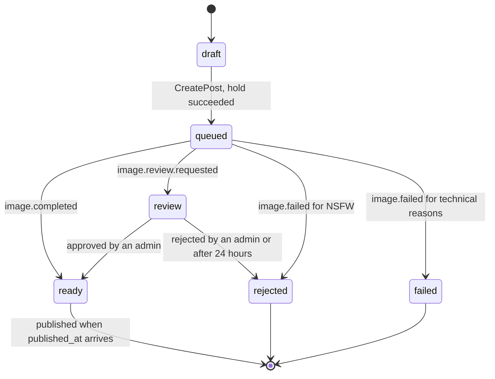
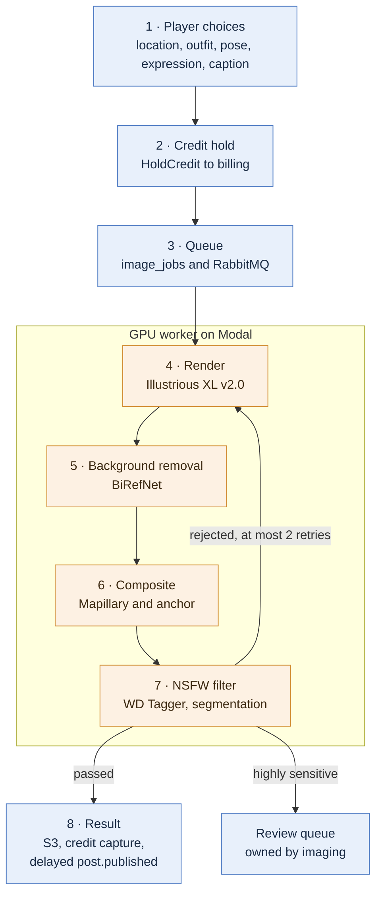
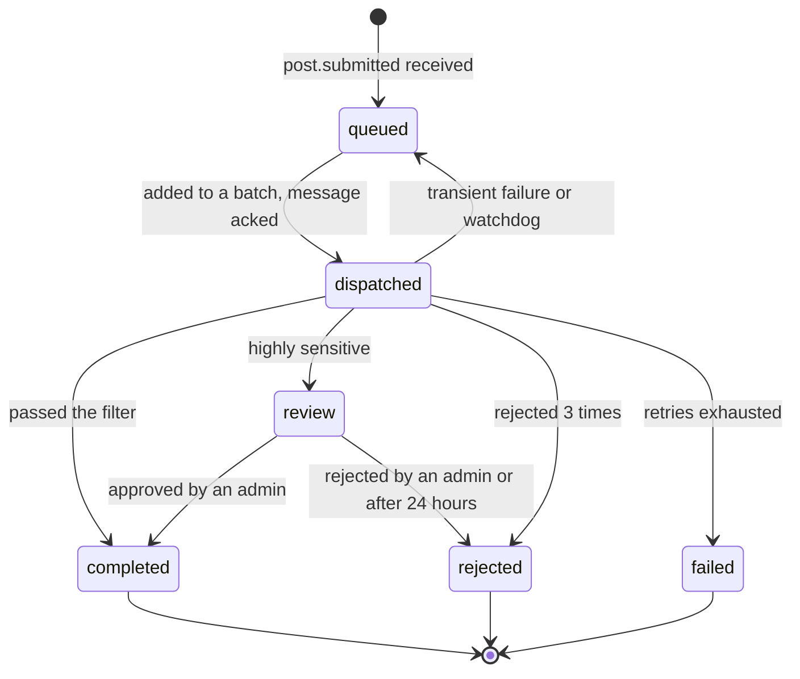
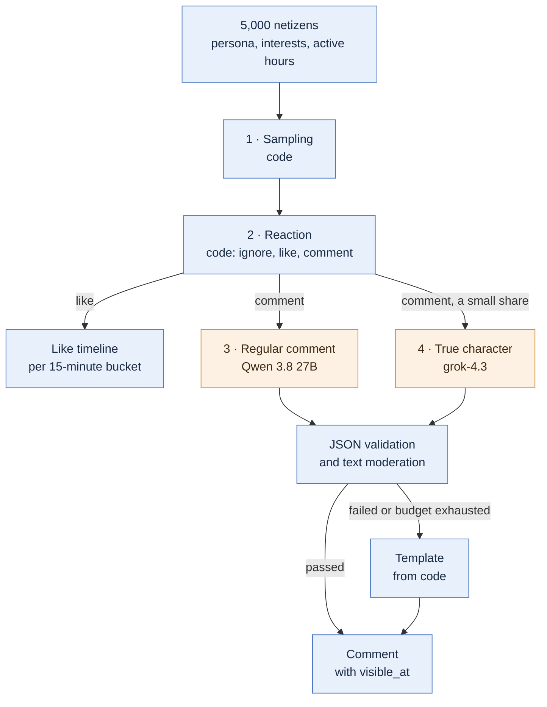
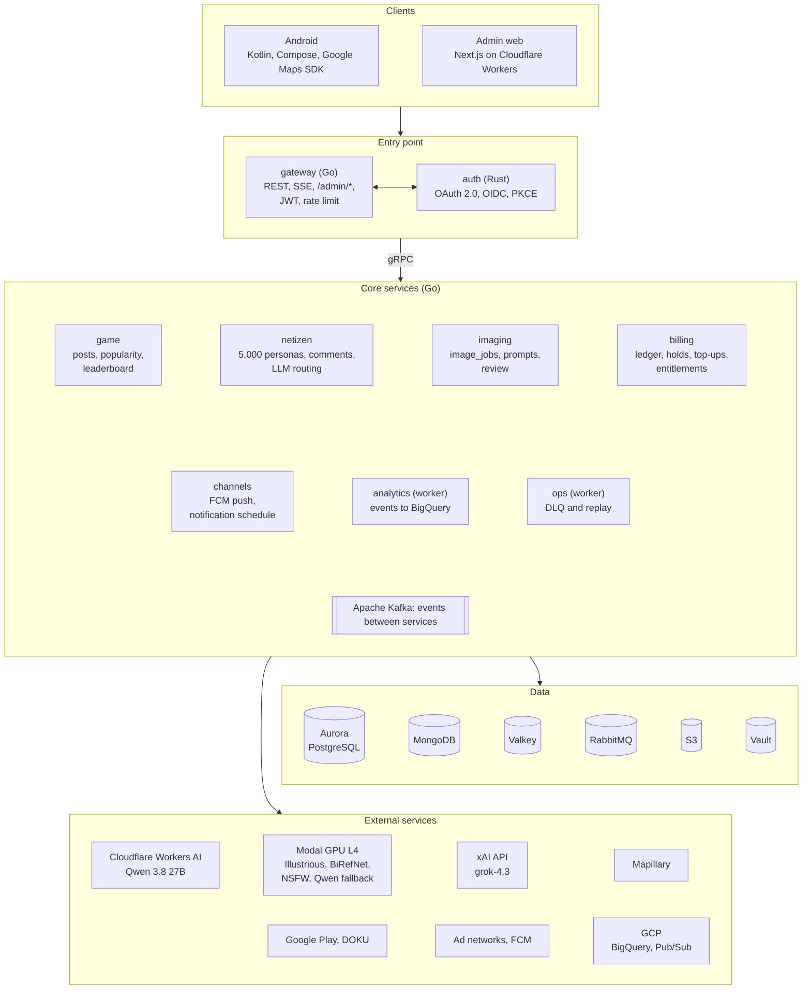
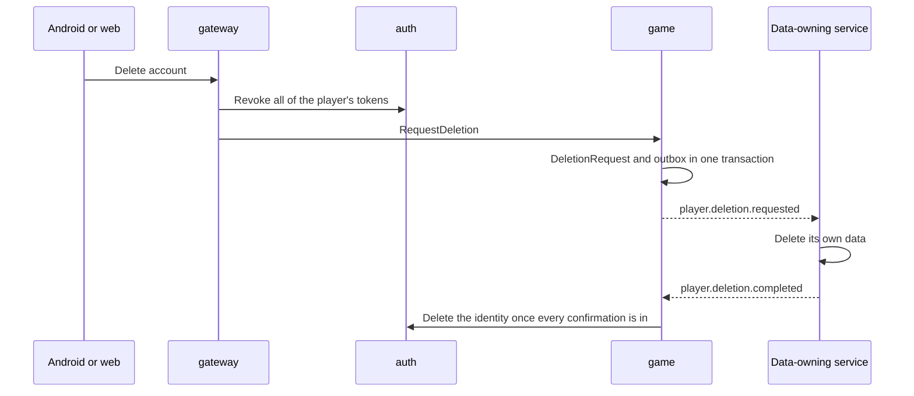
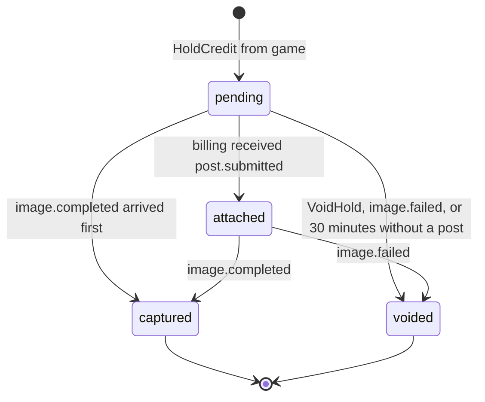

# Idol Venturing Out

**System design · version 3**

9 November 2026 · supersedes version 2 (9 November 2026) and the Hearthline design document (26 October 2026)

Idol Venturing Out (IVO) is an influencer-manager simulation game for Android. The player manages the career of a virtual idol who starts in her home city and then travels to other provinces and countries. Every post is a photo of the idol at a real location, and 5,000 AI netizens react to it.

The reasoning behind important decisions lives in the [Architecture Decision Records](adr/README.md), and the implementation details live in the [detailed design](detail/README.md).

**Contents**

1. [Summary](#1-summary)
2. [Changes from version 2](#2-changes-from-version-2)
3. [Key decisions](#3-key-decisions)
4. [Concept and gameplay loop](#4-concept-and-gameplay-loop)
5. [Content and age policy](#5-content-and-age-policy)
6. [Domain model](#6-domain-model)
7. [Time model](#7-time-model)
8. [Popularity engine](#8-popularity-engine)
9. [Photo pipeline](#9-photo-pipeline)
10. [Netizen pipeline](#10-netizen-pipeline)
11. [NSFW moderation](#11-nsfw-moderation)
12. [System architecture](#12-system-architecture)
13. [Inter-service communication](#13-inter-service-communication)
14. [Data storage](#14-data-storage)
15. [LLM layer](#15-llm-layer)
16. [Security](#16-security)
17. [Privacy, data export, and account deletion](#17-privacy-data-export-and-account-deletion)
18. [Billing and monetization](#18-billing-and-monetization)
19. [Capacity and cost](#19-capacity-and-cost)
20. [Observability](#20-observability)
21. [Infrastructure and deployment](#21-infrastructure-and-deployment)
22. [CI/CD](#22-cicd)
23. [Testing strategy](#23-testing-strategy)
24. [Repository structure](#24-repository-structure)
25. [Experiments](#25-experiments)
26. [Milestones](#26-milestones)
27. [CV coverage map](#27-cv-coverage-map)
28. [Component licenses](#28-component-licenses)
29. [Open questions](#29-open-questions)
30. [Sources](#30-sources)

## 1. Summary

Two principles drive the whole design:

- **Code owns the game state; AI models only fill in content.** Popularity, the economy, and netizen decisions are computed deterministically by code. LLMs only write comments, and image prompts are assembled from allowed tags. As a result the game is testable, costs stay under control, and content stays within policy.
- **Time is data.** Every effect carries its own effective time. Comments that appear gradually, followers that grow, and posts that go live at the chosen time are all read with a time filter, without a separate scheduler service ([section 7](#7-time-model)).

Goals of the project as a portfolio piece:

- LLM integration in production: routing across providers with quota-based fallback, structured output, evals, and cost tracking.
- A serverless image generation pipeline with batching, background removal, compositing, and layered NSFW moderation.
- Event-driven microservices with Apache Kafka, gRPC, Protobuf, RabbitMQ, and MongoDB.
- Cloud and operations: AWS with Terraform, Kubernetes (k3s), Vault, OpenTelemetry, CI/CD, layered testing, and BigQuery.
- Native Android (Kotlin) and a self-built auth server (Rust, from my thesis).
- Measured numbers: cost per image, cost per 1,000 comments, latency, and moderation precision and recall.

Out of scope for the v1 release: story and chapters (deferred; v1 is posting only), chatting with the idol, iOS, LoRA, and adult content.

## 2. Changes from version 2

The concept and milestones are unchanged. Version 3 resolves six places where version 2 contradicted itself, adds the parts that were missing, and replaces Redpanda with Apache Kafka as the event bus.

**Contradictions in version 2**

| # | Problem in version 2 | Fix in version 3 | Reference |
|---|---|---|---|
| 1 | Credit reservations expired after 30 minutes, even though batches run hourly and the p95 target for a photo session is 70 minutes. By the time `image.completed` arrived, the reservation was already gone. | Credit holds with authorize, capture, void. The 30-minute limit only applies until the hold is attached to a post. | [§18](#18-billing-and-monetization), [ADR-0011](adr/0011-credit-holds-authorize-capture-void.md) |
| 2 | The admin web app on Cloudflare Workers was listed as an event bus consumer, but Workers are request-scoped and cannot be members of a consumer group. | The review queue belongs to imaging, DLQ messages are stored by the `ops` worker, and the admin web app reaches both through `/admin/*` routes on the gateway. | [§12](#12-system-architecture), [ADR-0016](adr/0016-admin-web-through-gateway.md) |
| 3 | The outbox and `processed_events` lived in Aurora, but the netizen service writes its effects to MongoDB. Without a shared transaction, the idempotency guarantee did not hold. | Netizen idempotency through deterministic IDs and upserts. | [§10](#10-netizen-pipeline), [ADR-0013](adr/0013-deterministic-netizen-idempotency.md) |
| 4 | Popularity was computed lazily, but there was no mechanism for the leaderboard, scheduled publish times, or gradual comment release. | `effective_at` on every effect, a delayed outbox with `available_at`, and a periodic leaderboard fold. | [§7](#7-time-model), [ADR-0012](adr/0012-time-as-data.md) |
| 5 | `terraform destroy` wiped the EC2 volume holding Vault, MongoDB, and the event bus, including the JWT signing key. | Terraform is split into a persistent stack and an ephemeral stack; cluster data lives on an EBS volume that is never destroyed. | [§21](#21-infrastructure-and-deployment), [ADR-0015](adr/0015-persistent-and-ephemeral-terraform.md) |
| 6 | Moving a job from the event bus to RabbitMQ was not atomic, so a job could be rendered twice. Messages held unacked while waiting for a batch also hit RabbitMQ's acknowledgement timeout (30 minutes by default). | The `image_jobs` table in Postgres is the source of truth. RabbitMQ only delivers `job_id`, and messages are acked before the GPU starts working. | [§9](#9-photo-pipeline), [ADR-0014](adr/0014-image-jobs-in-postgres.md) |

**Additions**

- Apache Kafka in KRaft mode replaces Redpanda as the event bus ([ADR-0001](adr/0001-kafka-as-event-bus.md)). Since Kafka 4.0, one process can be both broker and controller without ZooKeeper, so a single node with a capped heap fits on the k3s node, and the services keep the same Kafka client.
- New sections: [time model](#7-time-model), [privacy, data export, and account deletion](#17-privacy-data-export-and-account-deletion), and [capacity and cost](#19-capacity-and-cost).
- Comment prompts use text context and WD Tagger tags instead of sending the image to the LLM ([ADR-0017](adr/0017-text-only-comment-prompts.md)).
- Comments that fail to generate fall back to code templates, so the comment count always matches the engagement.
- A global rate limiter per LLM provider, shared by all replicas.
- Span links at async boundaries, replacing a single trace that would live for hours ([ADR-0018](adr/0018-span-links-at-async-boundaries.md)).
- `rules_version` on every PopularityEvent, and likes stored as counts per time bucket.
- Retention rules for the 1 GiB Aurora storage limit.
- `ReserveCredit` became `HoldCredit`; the ledger entries `reserve`, `commit`, and `release` became `hold`, `capture`, and `void`.
- The daily reward belongs entirely to billing, because credits belong to billing. Cosmetics and subscriptions are entitlements owned by billing.
- A refund larger than the balance is recorded as credit debt, so the available balance is never negative.
- Smaller details: JWS output from Vault Transit, refresh token reuse detection, Google Play RTDN through a Pub/Sub pull subscription, Workload Identity Federation for BigQuery, a Neurons counter that can be rebuilt, seeds per attempt, and placement anchors for Mapillary photos.

## 3. Key decisions

Every decision as of 9 November 2026 is in this table; the other sections explain the details. Rows that changed or were added in version 3 are marked **v3**.

| Area | Decision | Notes |
|---|---|---|
| App name | Idol Venturing Out | Icon label: IVO. Play Store and domain availability not checked yet. |
| Player role | Idol manager | No relationship or romance storyline. |
| v1 scope | Posting, netizen reactions, popularity, leaderboard | Story and chapters deferred. |
| Age limit | 18+ | Follows PP Tunas; the age verification method is settled before the public release. |
| Production image model | Illustrious XL v2.0 STABLE | CreativeML Open RAIL-M. No LoRA and no face or hand detailer. |
| Anima | Personal tool only | Runs in the restricted Modal `personal` environment; its output is uploaded manually as assets. |
| Background removal | BiRefNet | MIT license. |
| Photo backgrounds | Mapillary | CC BY-SA 4.0, photographer credited on every post. |
| NSFW filter | WD Tagger v3, then an anime segmentation classifier | The second classifier is based on Ultralytics YOLO: fine for a portfolio, but its license is not clean enough for a public release. |
| Regular comment LLM | Qwen 3.8 27B | Cloudflare Workers AI while the daily quota lasts, then fallback to Modal. **v3:** text input only. |
| LLM for netizens' true character | `grok-4.3`, reasoning none | Netizens are labeled as AI accounts. |
| GPU | Modal L4 | Batched hourly or every 20 jobs, scale to zero, $30 of free credit per month. |
| Primary database | Aurora PostgreSQL Serverless | Express configuration on the Free plan: at most 4 ACU and 1 GiB per cluster. |
| Primary cloud | AWS Free plan, Jakarta region | An EC2 `m7i-flex.large` (8 GiB) as the k3s node. **v3:** persistent and ephemeral Terraform stacks. |
| GCP | BigQuery | Engagement analytics. **v3:** plus Pub/Sub for Google Play notifications. |
| Event bus | Apache Kafka in KRaft mode | **v3:** replaces Redpanda. One node is both broker and controller, with a capped heap. |
| Other data stores | MongoDB, Valkey, RabbitMQ, S3 | Netizens and comments live in MongoDB. |
| **v3** Image job queue | `image_jobs` table in Postgres, delivered through RabbitMQ | Postgres holds the job status; RabbitMQ handles the batch and express lanes and delayed retries. |
| **v3** Scheduling | Time as data and a delayed outbox | No separate scheduler service. |
| **v3** Credits | Holds with authorize, capture, void | A hold attached to a post never expires on wall-clock time. |
| Search | PostgreSQL full-text search | No Elasticsearch. |
| Payments | Google Play Billing or User Choice Billing (DOKU); web top-ups through DOKU | Sandbox first. PayPal optional on the web. |
| Monetization | Rewarded ads, daily rewards, top-ups | Money never buys popularity. Numbers decided later. |

## 4. Concept and gameplay loop

The player is a manager: they decide where the idol goes, what she wears, and when she posts. Popularity only grows from posts, while credits are only spent on making photos and buying cosmetics.

1. **Plan.** The player picks a destination on the map, an outfit, a pose, an expression, a caption, and a publish time.
2. **Photo session.** The post enters a queue and is processed in batches. In the game this shows as "photo shoot in progress" with an estimated finish time.
3. **Publish.** The photo appears in the in-game feed at the chosen publish time. The app only offers publish times after the estimated finish time; if the photo is late, the post goes live as soon as the photo is ready.
4. **Reactions.** AI netizens like and comment gradually over several hours.
5. **Progress.** Engagement grows followers and the popularity score. Popularity unlocks new regions: cities, then provinces, then other countries.

| Resource | Earned from | Spent on |
|---|---|---|
| Popularity (followers and engagement) | Posts and netizen reactions | Unlocking new destinations and leaderboard rank |
| Credits | Rewarded ads, daily rewards, top-ups | Making photos, regenerating, the express lane, cosmetics |

The two never convert into each other: credits cannot buy followers, and popularity cannot be sold. The daily posting limit is the same for every player, so the seasonal leaderboard stays fair.

## 5. Content and age policy

IVO is an SFW app for users aged 18+: sexually explicit content must never appear, in text or in images. This is a requirement of the Play Store and DOKU, and it keeps the project safe to show to recruiters ([ADR-0009](adr/0009-sfw-and-18-plus.md)).

- Every idol is an adult (in her 20s) and original, never a real idol or a character from an existing franchise.
- Users must be 18+. Under PP Tunas (Indonesia's 2025 regulation on protecting children online), a self-declared age checkbox is not enough, so the verification method is settled before the public release.
- Netizens are labeled as AI accounts in the app.
- Illustrious can produce adult content, so prevention and detection are layered.

| Layer | When | How | On failure |
|---|---|---|---|
| Image prompt | Before the GPU job | Only allowlisted tags; no free-form prompts; safety tags always in the negative prompt | Choices outside the list are rejected |
| Player caption | When posting | Blocklist and a lightweight text classifier | Caption rejected with a reason |
| Generated image | After rendering and compositing | WD Tagger, then the segmentation classifier ([section 11](#11-nsfw-moderation)) | Discarded, regenerated at most twice, then credits are returned |
| Netizen comment | When generated, before it is stored | Rules check and a text classifier | **v3:** replaced by a code template ([section 10](#10-netizen-pipeline)) |
| Player report | Any time | Review queue in the admin web app, stored by the service that owns the content | Handled by an admin |

Captions and comment text never appear in logs or traces, data is encrypted at rest, and players can export their data and delete their account ([section 17](#17-privacy-data-export-and-account-deletion)).

## 6. Domain model

Popularity and credits live in different services: popularity belongs to game, credits belong to billing. They never share a table.

| Entity | Contents | Owner |
|---|---|---|
| Player | Player account, the idol being managed, active season | game |
| Idol | Name, age (20+), fixed appearance tags, personality | game |
| Destination | City, province, or country; coordinates; popularity threshold; selected Mapillary photos and their attribution. **v3:** a placement anchor per photo (foot point, scale, light direction) | game |
| Post | Idol, destination, outfit, pose, expression, caption, chosen publish time, `published_at`, status, file location, image tags | game |
| PopularityEvent | Changes to followers and engagement (append-only), plus the latest snapshot. **v3:** `effective_at` and `rules_version` | game |
| Season, Leaderboard | Competition period (`starts_at`, `ends_at`) and its ranking | game |
| DeletionRequest (**v3**) | Status of account deletion and data export per service | game |
| ImageJob | Structured prompt, seed, priority, status, GPU seconds, NSFW scores. **v3:** attempt number and `batch_id` | imaging |
| ReviewItem (**v3**) | An image waiting for review, its scores, deadline, and the admin's decision | imaging |
| Netizen | Persona, type (simp, critic, place-focused, and others), interests, active hours, true character | netizen |
| Comment | Post, netizen, text, stage, model. **v3:** `visible_at` and text source (`llm` or `template`) | netizen |
| CreditAccount, LedgerEntry | Credit balance, top-ups, ad and daily rewards, purchases | billing |
| CreditHold (**v3**) | A hold per post or regeneration: amount, status, `ref_id`, creation time | billing |
| Entitlement (**v3**) | Owned cosmetics, active subscription, express lane rights | billing |

Stored post statuses: `draft`, `queued`, `review`, `ready`, `rejected`, or `failed`. **v3:** "published" is no longer stored as a status. A post counts as published when its status is `ready` and `published_at <= now()`. The `rendering` status moved to ImageJob, because game does not need to know when the GPU starts working.



## 7. Time model

Almost everything in IVO depends on the clock: publish times, hourly batches, comments that appear gradually, credit holds, daily rewards, and seasons. Version 3 uses one principle for all of them: **time is data**. An effect is not "run" by a scheduler at the right moment. It is written ahead of time together with the time it takes effect, and readers filter on that time ([ADR-0012](adr/0012-time-as-data.md)).

Three mechanisms cover every need:

1. **`effective_at` on every effect.** A PopularityEvent has `effective_at` and a comment has `visible_at`. Every query filters on `<= now()`, with `now` coming from `Clock`. Gradual release needs no process at all, only an index on the time column, and no event can be missed.
2. **A delayed outbox.** When a moment has to *trigger* an action in another service, the row is written to the outbox with `available_at`. The relay only publishes rows that are due, so scheduling happens inside the data transaction. Services that need their own schedule (channels, for pushes) use the same pattern in their own table with a `send_at` column.
3. **Periodic folds for global aggregates.** The leaderboard needs every player's score at once, so a job folds effective events into snapshots every 5 minutes and then updates a sorted set in Valkey.

| Event | Mechanism | Notes |
|---|---|---|
| Comments appear gradually | `visible_at` in MongoDB | No scheduler |
| Likes and followers grow | A PopularityEvent per 15-minute bucket, with `effective_at` = the time of the last reaction in the bucket | Decided once when the post is published; numbers never run ahead of the reactions |
| Post goes live at the chosen time | `post.published` in the outbox with `available_at = published_at` | `published_at` = the chosen time or the time the photo is ready, whichever is later |
| "New comment" push | Channels schedule table with `send_at` | Built from the timeline in `engagement.recorded` |
| Leaderboard | Fold into Valkey every 5 minutes | Postgres stays the source of truth |
| Image batch | Hourly tick or a threshold of 20 jobs in imaging | [Section 9](#9-photo-pipeline) |
| Orphaned credit holds | Billing sweeper every minute | [Section 18](#18-billing-and-monetization) |
| Daily rewards and daily limits | Keyed by WIB date (Asia/Jakarta, UTC+7), for example `2026-11-09` | The "reset" happens by itself when the date changes |
| End of a season | `ends_at` plus one last fold | The final ranking is frozen in Postgres |

**One post, step by step**

| Time | What happens | Written at |
|---|---|---|
| 18:05 | The player creates a post with publish time 19:30 | 18:05 |
| 19:00 | The batch is sent to Modal | 19:00 |
| 19:12 | The photo is ready; `post.published` enters the outbox with `available_at` 19:30 | 19:12 |
| 19:30 | The relay publishes `post.published`; netizen decides every reaction and writes the timeline of likes and comments with `visible_at` between 19:34 and 23:30 | 19:30 |
| 19:34 to 23:30 | Likes, followers, and comments "appear" without any process running; the app only reads what is `<= now()` | 19:30 |
| 19:40 | The "first comment" push is sent from the channels schedule table | 19:31 |

**Supporting rules**

- The relay picks unpublished rows with `available_at <= now()` using `FOR UPDATE SKIP LOCKED`, so several replicas can run at once without colliding.
- A delayed row can be published after a row that was written later. So every event carries its own `occurred_at` or `effective_at`, and consumers never depend on write order.
- Every service gets `Clock` from `pkg/clock`. End-to-end tests simulate a whole season in seconds.

## 8. Popularity engine

Engagement and followers are computed by code, deterministically and lazily, so no process updates every player every minute ([ADR-0002](adr/0002-lazy-deterministic-popularity.md)). The split: netizen decides each netizen's reaction because it needs persona data, while game turns reactions into followers and popularity because it needs the player's history.

- **Inputs are frozen (v3).** When the photo is ready, game computes the followers at the publish time from the events recorded so far, the location novelty, and the posting frequency penalty, and puts them into the `post.published` payload. Netizen only uses the numbers from the payload, so a replay at any time gives the same result.
- **The engagement score** for each post and netizen pair is computed from those inputs, how well the location and style match the netizen's interests, and the publish time compared with the netizen's active hours.
- **Penalties:** repeating the same location gives diminishing returns, and posting too often lowers engagement.
- **The seed** is derived from a hash of `post_id` and `netizen_id`, so the result is always the same, even after a restart or across several replicas.
- **Computed once, applied gradually (v3).** Every reaction is decided when `post.published` arrives, then stored as a timeline of 15-minute buckets. Each bucket's `effective_at` is the time of its last reaction, so the numbers never run ahead of the reactions. Followers at time t are the snapshot plus every event with `effective_at <= t`.
- **Likes as counts (v3).** Likes are stored as a count per bucket, not one row per netizen. Only comments have one record per netizen.
- **Event log:** every change is appended, then the snapshot is updated. Questions like "why did my followers drop yesterday?" can be answered from this log.
- **Rule versions (v3).** Every PopularityEvent stores its `rules_version`. New weights only apply to later posts; history is never rewritten.
- **The server is the source of truth:** every number is computed from server-side events; the app never sends engagement numbers.
- **A fake clock for testing:** the engine takes a `Clock` interface, so a whole season can be simulated in a few seconds.

**Leaderboard (v3).** The season score is the popularity that has already taken effect. A fold job in game runs every 5 minutes: effective events are folded into the snapshot in Postgres, then the sorted set in Valkey is updated. The app reads the ranking from Valkey. If Valkey is empty after a restart, the sorted set is rebuilt from the snapshot. After `ends_at`, a last fold freezes the season's final ranking in Postgres.

The formula weights and the popularity threshold per region are tuned during play testing.

## 9. Photo pipeline

The player only picks from lists, code assembles the prompt, and the GPU on Modal renders the idol on a neutral background before she is composited onto a real street photo.



*Figure 1. Photo pipeline. Blue: Go backend; orange: GPU worker on Modal. Steps 4 to 7 run in one Modal container per batch.*

1. **Player choices.** Location, outfit, pose, and expression are enums; values outside the lists are rejected. Cosmetic outfits are checked against game's copy of the entitlements.
2. **Credit hold.** game calls `billing.HoldCredit` over gRPC with `hold_id = post_id`. If the balance is too low, the post is not created. The hold lifecycle is described in [section 18](#18-billing-and-monetization).
3. **Queue.** imaging consumes `post.submitted`, then writes an `image_jobs` row (unique per `post_id` and regeneration number), `processed_events`, and an outbox row in one Postgres transaction. The relay sends `job_id` to RabbitMQ. Dispatch details are below.
4. **Prompt builder.** Fixed tags for the idol, outfit, pose, expression, framing, and lighting that matches the destination's local time, plus safety tags in the negative prompt. **v3:** seed = hash(`job_id`, `attempt`). A job retried after a disruption produces the same image, while a re-render after a rejection uses a new seed that is still reproducible.
5. **Render.** Illustrious XL v2.0 on an L4 GPU. The model is loaded once per batch, then 2–3 images are generated at a time; the final batch size will be measured.
6. **Background removal and compositing.** BiRefNet separates the idol from the background, then the idol is pasted onto the Mapillary photo from the nearest point. **v3:** foot position, scale, and light direction come from the placement anchor stored per photo when the destination is curated in the admin web app. The hardest part is done once, offline, and the runtime stays deterministic.
7. **NSFW filter.** WD Tagger, then the segmentation classifier ([section 11](#11-nsfw-moderation)). A rejected image is re-rendered in the same container with the next attempt, at most twice. WD Tagger tags from the final image are stored for the comment prompt ([section 10](#10-netizen-pipeline)).
8. **Result.** The image is uploaded to S3 through a presigned PUT URL, so Modal never holds AWS credentials. imaging publishes `image.completed` or `image.failed`. billing captures or voids the hold. game computes `published_at`, stores the image tags, and writes `post.published` to the delayed outbox ([section 7](#7-time-model)).

**Queue and dispatch (v3)**

Postgres holds the job status, while RabbitMQ only delivers `job_id` ([ADR-0014](adr/0014-image-jobs-in-postgres.md)).

- **Two lanes.** imaging's outbox relay sends `job_id` to the `image.batch` or `image.express` queue, with publisher confirms.
- **Batch.** Every minute, the dispatcher checks the depth of `image.batch` without taking any messages. When the depth reaches 20, or on the hourly tick, the dispatcher takes up to 20 messages, marks the jobs `dispatched` with a `batch_id` in Postgres, acks the messages, and then calls Modal. Messages are never held unacked while waiting or while the GPU works, so RabbitMQ's acknowledgement timeout (30 minutes by default) is never reached.
- **Express** is consumed continuously and dispatched immediately, with the same mark-then-ack pattern.
- **Dedupe.** Jobs whose status is no longer `queued` are skipped, so duplicate messages never trigger duplicate renders.
- **Delayed retries.** Transient failures, such as errors or timeouts on Modal, are resent through a delay queue with a TTL and a dead-letter exchange. Retried jobs get a higher priority so they don't queue from the back again. After the retry limit, the job becomes `failed`.
- **Watchdog.** `dispatched` jobs that exceed the batch time limit go back to `queued`. Because the seed is the same, the re-render produces the same image.
- Modal is called asynchronously with `batch_id` as the idempotency key, and results are matched by `job_id`. If the queue is empty, Modal is not called at all.



**Modal configuration**

- The `prod` environment runs the production workers. The restricted `personal` environment runs ComfyUI and Anima; the production service user has no access to it.
- Model weights live on a Modal Volume, the minimum container count is 0, and imaging has a circuit breaker. When Modal has problems, jobs wait in the delay queue; when retries run out, the job fails and the hold is voided.
- A presigned PUT URL is created per job at dispatch and stays valid for the duration of the batch.
- An L4 costs $0.80 per hour, billed per second. The $30 of free credit per month is shared with the Qwen fallback ([section 10](#10-netizen-pipeline)).
- Cold start and generation time are measured in the experiments; a pose library built up front could reduce GPU usage.

## 10. Netizen pipeline

5,000 AI netizens react through four stages. The first two are pure code, so most candidates never call an LLM.



*Figure 2. Netizen pipeline. Blue: code; orange: LLM. Engagement is decided in stage 2, before any LLM is called, so the LLM only writes comment text.*

1. **Sampling (code).** When `post.published` arrives, netizens are selected by their interests (location and style) and their active hours. Every number, such as followers, location novelty, and penalties, comes from the event payload frozen at publish time ([section 8](#8-popularity-engine)).
2. **Reaction (code).** The score is turned into a probability with a sigmoid, then drawn with a deterministic seed: ignore, like, or comment. The result is a timeline of 15-minute buckets, sent once through `engagement.recorded`. Because the final engagement is decided here, LLM failures never change the numbers.
3. **Regular comments (Qwen 3.8 27B).** 10–20 personas per request, so each netizen keeps a distinct voice. **v3:** the input is text: the post's structured context (destination, outfit, pose, expression, caption, publish time) plus WD Tagger tags from the final image. Code already knows what is in the photo because code assembled the prompt, so the model doesn't need to see the image ([ADR-0017](adr/0017-text-only-comment-prompts.md)). The JSON output contains `netizen_id` and the text, and it is validated before it is stored.
4. **True character (`grok-4.3`, reasoning none).** A small share of netizens show their true personality, for example sharp criticism or fanatical devotion.
5. **Gradual release.** Every comment is stored with a `visible_at` spread over several hours. No process "releases" comments; the app only reads comments with `visible_at <= now()` ([section 7](#7-time-model)). If the text isn't ready when its time comes, the comment appears as soon as the text is ready.

**Units of work and idempotency (v3)**

- After reactions are decided, netizen splits the comments into chunks of 10–20 personas and writes one message per chunk to the internal topic `netizen.comment.requested`. Comment workers autoscaled by KEDA consume this topic.
- `event_id` is derived from `post_id`, the event type, and the chunk number, so the consumer discards redelivered messages.
- Comments are unique per (`post_id`, `netizen_id`). Retries are upserts, and the LLM is not called for netizens whose comment already exists.
- The order is produce first, then commit the offset (at-least-once); the deterministic IDs absorb duplicates. netizen doesn't use an outbox because its data lives in MongoDB, not Postgres ([ADR-0013](adr/0013-deterministic-netizen-idempotency.md)).

**Degradation (v3).** The text is replaced by a code template (a library of short sentences per netizen type) when the LLM still fails after retries, its output stays invalid, moderation rejects the comment, or the daily budget runs out. The comment count still matches the engagement, and the `source` field records `llm` or `template` so the ratio can be monitored.

**Qwen routing: Cloudflare first, Modal as the fallback**

| Condition | Route |
|---|---|
| Cloudflare's daily allowance is not used up | Workers AI, model `@cf/qwen/qwen3.8-27b` |
| The daily Neurons counter passes the limit, or HTTP 429 with code `3036` | The rest of that hour's comment queue is processed in one run on Modal |
| HTTP 429 with code `3040` (out of capacity) | Retry with backoff |

- The free Workers AI allowance is 10,000 Neurons per day, reset at 00:00 UTC (07:00 WIB). At this model's rates that is about 34 thousand output tokens, or roughly 300–600 short comments per day.
- On Workers Paid, usage beyond the allowance is billed instead of failing, so the main trigger is our own Neurons counter in Valkey. **v3:** this counter is rebuilt from the cost ledger (`usage.recorded`) if Valkey restarts.
- **v3:** the small Cloudflare allowance goes to the comments with the earliest `visible_at`, so the first comments on each post appear quickly. The rest is processed in a Modal batch.
- The Modal fallback uses vLLM: 4-bit quantization fits on an L4 (about 14 GB), while FP8 needs an L40S (about 27 GB), not counting the KV cache.

## 11. NSFW moderation

The image filter runs as a cascade: WD Tagger first, then the segmentation classifier only for images that pass. Both finish within milliseconds on the GPU, far less than the cost of rendering ([ADR-0005](adr/0005-nsfw-moderation-cascade.md)).

| Stage | Model | Rule |
|---|---|---|
| 1 | WD Tagger v3, a small variant (ViT, ConvNeXt, or SwinV2), Apache-2.0 | High questionable or explicit rating: reject. High sensitive rating: review queue. |
| 2 | Anime NSFW segmentation classifier (ntd11 v5) | Explicit body parts detected: reject. |

- **Rejected:** the image is discarded and never stored. Only the scores, the model version, and the hash are recorded.
- **Review (v3):** the image is stored temporarily (encrypted, under an S3 prefix with a lifecycle rule) and enters imaging's `review_items` table. imaging announces it on the `image.review.requested` topic, and an admin decides through the admin web app, the gateway, and then imaging. A review that isn't decided within 24 hours counts as rejected, and its hold is voided.
- **Anti-spam:** a daily generation limit and a cooldown for players whose images are often rejected. The GPU cost is already spent at render time, so prevention at the player level saves the most.
- **Second classifier:** the pickle-based `.pt` file is opened once in an isolated environment, exported to ONNX, and then run with onnxruntime. Its weights have no stated license and the model is based on Ultralytics (AGPL-3.0), so it must be replaced or licensed before a public release.
- **Operations:** new thresholds are tested in shadow mode first; admin decisions become labeled data; an alert fires when the rejection rate spikes.
- **The evaluation set** comes from our own output, labeled by hand, without any data involving children.

## 12. System architecture

IVO consists of six Go services, two Go workers (analytics and ops), one Rust auth server, and a Python GPU worker on Modal. Service boundaries follow data ownership: every piece of data has exactly one owning service.



*Figure 3. IVO architecture. gRPC is only for synchronous calls; everything else goes through Kafka. The admin web app isn't connected to Kafka; all of its access goes through the gateway.*

| Component | Language | Responsibilities |
|---|---|---|
| gateway | Go | REST and SSE for Android, `/admin/*` routes for the admin web app, JWT validation through JWKS, RBAC, rate limiting, idempotency keys |
| game | Go | Idols, destinations, posts, the popularity engine, seasons and the leaderboard, the entitlement copy, coordinating account deletion and data export |
| netizen | Go | Netizen personas, sampling and reactions, the comment pipeline, LLM routing, text moderation, fallback templates |
| imaging | Go | `image_jobs` and batches, the prompt builder, calls to Modal, S3 presigned URLs, the review queue |
| billing | Go | Credit ledger, holds, DOKU top-ups, Google Play purchase verification, ad and daily rewards, entitlements, cost ledger |
| channels | Go | Push notifications through FCM and the notification schedule (`send_at`) |
| analytics | Go (worker) | Streams events from Kafka to BigQuery with pseudonymized player IDs |
| ops | Go (worker) | Stores DLQ messages and replays them when an admin asks |
| auth | Rust (Actix Web) | OAuth 2.0 and OIDC, PKCE, RBAC, JWKS, signing through Vault |
| GPU worker | Python on Modal | Illustrious, BiRefNet, compositing, WD Tagger, the segmentation classifier, the Qwen fallback |
| admin web | Next.js on Cloudflare Workers | NSFW review queue, ledger, daily costs, job monitor, DLQ, destination and anchor curation; all of it through the gateway |
| Android | Kotlin, Jetpack Compose | The player app: map, posting, feed, credits |

## 13. Inter-service communication

gRPC is used only when the caller needs an immediate answer; everything else goes through Kafka events ([ADR-0001](adr/0001-kafka-as-event-bus.md)). RabbitMQ only delivers image jobs (batch and express lanes, delayed retries, priorities), while job status stays in Postgres and events stay in Kafka.

**gRPC**

| Service | RPC | Called by | Why synchronous |
|---|---|---|---|
| game | `CreatePost` | gateway | The player needs the post ID and the result of validating their choices |
| billing | `HoldCredit`, `VoidHold` | game | A post is rejected immediately if the balance is too low; void is called if game's transaction fails |
| billing | `GetBalance` | gateway | Shows the balance in the app |
| game | `GetPostContext` | netizen | The caption and the descriptive text about the idol and destination for the comment prompt. The caption is deliberately left out of every event, and its content never affects the numbers |
| game | `RequestDeletion`, `RequestExport` | gateway | The player needs confirmation that the request was recorded |
| imaging | `ListReviews`, `ResolveReview` | gateway (admin) | Admins need the list and the result of their decision immediately |
| imaging | `GetJobStatus` | billing | Reconciles holds that have been attached for a long time |
| ops | `ListDeadLetters`, `Replay` | gateway (admin) | Admins view and resend DLQ messages |

This table only lists calls that change state or that cross-service flows need. Read RPCs for the app, such as `ListPosts`, `ListComments`, and `GetLeaderboard`, are in the [proto contracts](../proto/README.md) and the [API gateway](detail/api-gateway.md) design.

**Kafka topics**

| Topic | Producer | Consumer | Key |
|---|---|---|---|
| `post.submitted` | game (outbox) | imaging, billing | `player_id` |
| `image.completed`, `image.failed` | imaging | game, billing, channels | `player_id` |
| `image.review.requested` | imaging | game, channels, analytics | `player_id` |
| `post.published` | game (delayed outbox) | netizen, channels, analytics | `post_id` |
| `netizen.comment.requested` | netizen | netizen (comment workers) | `post_id` and chunk number |
| `engagement.recorded` | netizen | game, channels, analytics | `player_id` |
| `credit.hold.failed` | billing | game, imaging | `player_id` |
| `payment.completed` | billing | channels, analytics | `player_id` |
| `entitlement.granted`, `entitlement.revoked` | billing | game, analytics | `player_id` |
| `usage.recorded` | netizen, imaging | billing (cost ledger), analytics | `player_id` |
| `player.deletion.requested`, `player.export.requested` | game (outbox) | every service that owns data | `player_id` |
| `player.deletion.completed`, `player.export.completed` | each service that owns data | game | `player_id` |
| `*.dlq` | every consumer | ops | same as the source topic |

- **Protobuf** for all RPCs and event payloads, in a single `proto/` folder. CI runs `buf lint` and `buf breaking`.
- **Trace context** (W3C `traceparent`) is carried in HTTP headers, gRPC metadata, and message headers.
- **Transactional outbox:** data changes and the outbox row are written in one transaction, then the relay publishes to Kafka, or to RabbitMQ for imaging jobs ([ADR-0008](adr/0008-transactional-outbox.md)). **v3:** the `available_at` column makes the outbox double as a scheduler ([section 7](#7-time-model)).
- **Idempotent consumers:** each processed `event_id` is recorded in `processed_events` in the same transaction as its effects. Delivery is at-least-once. **v3:** netizen uses deterministic IDs and upserts because its data is in MongoDB ([section 10](#10-netizen-pipeline)).
- **Payloads carry frozen inputs (v3):** events that trigger computation, such as `post.published`, carry every number the consumer needs, so a replay at any time gives the same result.
- **Tiered retries** with growing delays, then the DLQ after the attempt limit. **v3:** the `ops` worker stores DLQ messages in a table; a replay republishes the message to its source topic with a `replay_of` header.
- **Per-player ordering:** one player's events land in the same partition, so their popularity is never updated in a race.
- **Schema evolution:** new fields are always optional; breaking changes use a new versioned topic, for example `post.submitted.v2`.

## 14. Data storage

Aurora PostgreSQL is shared, but every service has its own schema and database user, with no cross-schema queries.

| Store | Used for | Owner |
|---|---|---|
| Aurora PostgreSQL Serverless | Primary data for game, billing, imaging (including `image_jobs` and `review_items`), auth, and ops; outbox; `processed_events`; full-text search | Each service |
| MongoDB | Netizen personas, comments, per-post processing status | netizen |
| Valkey | Rate limits, a global rate limiter per LLM provider, the daily Neurons counter, caches, the leaderboard sorted set, Pub/Sub for SSE | gateway, netizen, game |
| RabbitMQ | Image job delivery: batch and express lanes, delayed retries | imaging |
| S3 | Finished photos (private, opened through presigned URLs), temporary review images, Vault and MongoDB backups | imaging; backups are managed by infrastructure scripts |
| Kafka | Event log with 7-day retention | Every service |
| Modal Volume | Model weights | GPU worker |
| BigQuery | Engagement and funnel analytics, in a dataset in the Jakarta region (`asia-southeast2`) | analytics |

- On the Free plan, Aurora's express configuration is limited to at most 4 ACU and 1 GiB of storage per cluster, with at most 2 clusters. That is enough to start with because comments live in MongoDB ([ADR-0020](adr/0020-mongodb-for-netizens.md)).
- The express configuration sits outside the VPC behind an internet access gateway and uses IAM authentication. Go services create an IAM token for every connection.
- After upgrading to the Paid plan, those limits are lifted and capacity scales up and down automatically with load.
- Migrations are managed per service and run before a new version goes live. Locally, Aurora is replaced by plain PostgreSQL and S3 by MinIO, and Vault runs in dev mode.

**Retention (v3).** The 1 GiB limit means that data which keeps growing has to be trimmed:

| Data | Rule |
|---|---|
| Published outbox rows | Deleted after 3 days; until then they double as a replay backup if Kafka loses data ([ADR-0010](adr/0010-single-node-kafka.md)) |
| `processed_events` | Deleted after 30 days, longer than Kafka's retention (7 days) plus the maximum age of a DLQ message that may still be replayed |
| DLQ messages in the `ops` table | Can be replayed for up to 14 days, then deleted |
| PopularityEvent | Once folded into the snapshot and older than one season, archived to S3 (Parquet) and BigQuery, then deleted from Aurora |
| Review images in S3 | A lifecycle rule deletes them after 7 days |

Everything in Valkey can be rebuilt from Postgres: the leaderboard from the snapshot, and the Neurons counter from the cost ledger. So Valkey is treated as a cache.

## 15. LLM layer

Every LLM call goes through one module in the netizen service with an interface per role, so a model can be swapped through config without code changes.

| Role | Model | Route | Settings |
|---|---|---|---|
| Regular comments | Qwen 3.8 27B (Apache-2.0) | Cloudflare Workers AI, Modal as the fallback ([ADR-0004](adr/0004-qwen-on-cloudflare-with-modal-fallback.md)) | JSON schema, 10–20 personas per request. **v3:** text input only |
| True character | `grok-4.3` | xAI API | `reasoning_effort: "none"` |
| Text moderation | A lightweight classifier | Not chosen yet | Player captions and outgoing comments |

- **Reliability:** timeouts per role, retries with exponential backoff for 429 and 5xx errors, a circuit breaker per provider, and JSON validation. **v3:** output that is still invalid after one retry is replaced by a template instead of being dropped.
- **Global rate limiter (v3):** a token bucket per provider in Valkey, shared by all replicas. KEDA may add replicas, but the call rate to each provider is still limited in one place. `netizen.comment.requested` has at least as many partitions as KEDA's `maxReplicaCount`.
- **Cost tracking:** every call records the model, the tokens or Neurons, and the cost, and sends them through `usage.recorded`. There is a daily budget with an alert when it is exceeded. **v3:** once the daily budget runs out, comments use templates until the budget resets.
- **Nightly evals:** fixed scenarios that measure how distinct the persona voices are, how natural and casual the language is, and policy compliance, graded by an LLM-as-judge with a rubric. Prompt versions are stored in the repo and recorded in traces. **v3:** the same evals are used to find the smallest model that still passes the rubric ([section 25](#25-experiments)).

## 16. Security

Every player and service authenticates through a self-built auth server (Rust, Actix Web, from my thesis). Token signing keys are stored and rotated in Vault, and the private key never leaves Vault ([ADR-0007](adr/0007-token-signing-through-vault-transit.md)).

**Player authentication**

- OAuth 2.0 Authorization Code with PKCE and OIDC; Android uses AppAuth through Custom Tabs.
- 15-minute JWT access tokens and refresh tokens that rotate on every use. **v3:** an old refresh token that is used again counts as leaked, so the whole chain of tokens derived from it is revoked (reuse detection).
- RBAC with the roles `user`, `reviewer`, and `admin`.

**Signing and key rotation**

- The auth server asks Vault Transit to sign JWTs. **v3:** for ECDSA (ES256) keys, sign is called with `marshaling_algorithm=jws`, so Vault returns the signature directly in JWS format, URL-safe base64. The auth server only has to strip the `vault:v1:` prefix and make sure there is no `=` padding.
- The JWKS publishes the latest key version and the previous one, told apart by `kid`. Keys rotate monthly, and the added latency is measured.
- Token verification never touches Vault: the gateway validates JWTs with a cached JWKS. Vault is only needed when tokens are issued.

**Between services, and secrets**

- gRPC calls use client-credentials tokens with a per-service audience; NetworkPolicy limits who may talk to whom.
- Secrets live in Vault (KV) and are synced to pods by the Vault Secrets Operator; Vault auto-unseals with AWS KMS. This includes the Cloudflare, xAI, Mapillary, and Modal API keys.
- Connections to Aurora use IAM authentication; GitHub Actions signs in to AWS through OIDC without static access keys.
- **v3:** analytics reaches BigQuery through Workload Identity Federation using the EC2 IAM role's identity, with no service account key file.

**The outer boundary**

- DOKU webhooks are verified with an HMAC signature and an amount check, then processed idempotently.
- Google Play purchase tokens are verified on the server through the Google Play Developer API. **v3:** a purchase is acknowledged only after its ledger entry is written; Google automatically refunds purchases that aren't acknowledged within 3 days.
- **v3:** refunds and subscription changes arrive as real-time developer notifications from a Pub/Sub **pull** subscription. Notifications keep waiting in Pub/Sub while the AWS environment is down (7-day retention by default). Each notification only says that something changed, so billing still calls the Play Developer API for the full status.
- Ad rewards are granted only after the signature on the ad network's server-side verification callback is verified.
- S3 buckets are private; there are rate limits per player and per IP; CI scans dependencies and images (govulncheck, cargo audit, npm audit, Trivy).

## 17. Privacy, data export, and account deletion

Captions and comment text never appear in logs or traces, and data is encrypted at rest. Players can export their data and delete their account, both from the app and from a web page. The Play Store requires both for apps that let users create an account ([ADR-0019](adr/0019-account-deletion-saga-and-crypto-shredding.md)).

**Account deletion (v3)**

game coordinates the deletion because game owns the Player entity.



| Service | What is deleted |
|---|---|
| game | Player, idol, posts, PopularityEvents, leaderboard entries, and the player's delayed outbox rows |
| imaging | `image_jobs`, reviews, and S3 objects (photos and review images) |
| netizen | Comments on the player's posts; netizen personas stay because they belong to the system |
| billing | Balance, holds, and entitlements; ledger entries are pseudonymized, not deleted, because they are transaction records |
| channels | FCM tokens and notification schedules |
| analytics | The player's pseudonymization key (crypto-shredding) |
| auth | Identity and credentials, as the last step |

- **No late events.** The player's delayed outbox rows and push schedules are deleted too, so no `post.published` or notification goes out after the account is deleted.
- **Crypto-shredding for analytics.** Events sent to BigQuery use `player_pid = HMAC(player_key, player_id)`. analytics stores the per-player key in its own table, encrypted through Vault Transit. Once the key is deleted, none of that player's analytics rows can be linked back to the person, without a large DELETE in BigQuery.
- **Data that expires on its own.** Events in Kafka disappear within 7 days (retention), and MongoDB backups in S3 have a 14-day lifecycle.
- **Monitoring.** A request that is still incomplete after 24 hours triggers an alert.

**Data export (v3).** Same pattern: game publishes `player.export.requested`, every service writes its part under that request's S3 prefix and then sends `player.export.completed`. Once every part is in, the player receives one presigned URL that is valid for 24 hours.

## 18. Billing and monetization

Billing is an append-only credit ledger: the balance is never changed directly but computed from ledger entries.

| Entry | When it is written | Effect on the available balance |
|---|---|---|
| `topup` | A verified purchase through Google Play or DOKU | Increases |
| `ad_reward` | A server-side verification callback from the ad network | Increases |
| `daily_reward` | The daily claim, once per WIB date | Increases |
| `hold` (v2: `reserve`) | `HoldCredit` before a photo job or a regeneration | Decreases temporarily |
| `capture` (v2: `commit`) | `image.completed` received | The hold becomes permanent |
| `void` (v2: `release`) | `image.failed` (including NSFW and review rejections), `VoidHold`, or an orphaned hold | Returned |
| `purchase` (**v3**) | Buying a cosmetic with credits | Decreases |
| `refund` | A refund from Google Play or DOKU | Decreases |
| `adjustment` | A manual correction by an admin, which requires a reason | Per the correction |

- **Idempotent:** the pair of source ID and entry type is unique, so a duplicate event never deducts the balance twice.
- Balance updates take a row lock per account.
- **Refunds larger than the balance (v3):** the available balance is reduced to zero, and the difference is recorded as credit debt that is paid off from the next incoming credits. That way the available balance is never negative.
- **Reconciliation:** pending DOKU payments are re-checked every 15 minutes, with the same pattern as Menikstore. **v3:** holds that have been attached for more than 3 hours are checked against `imaging.GetJobStatus` with the same pattern.

**Credit holds (v3)**

New posts and regenerations use the authorize, capture, void pattern of card payments ([ADR-0011](adr/0011-credit-holds-authorize-capture-void.md)).



- `hold_id` equals `post_id` (or the regeneration ID), so repeated `HoldCredit` calls are idempotent.
- A `pending` hold covers the gap between the gRPC call and game's transaction commit. If game's transaction fails, game calls `VoidHold`. If game crashes before it can, billing's sweeper voids holds that are not attached within 30 minutes. The 30-minute limit from version 2 still exists, but it only applies at this stage.
- An `attached` hold has no time limit. It only ends through `image.completed` (capture) or `image.failed` (void), including NSFW rejections and reviews that are rejected or expire. The hourly queue, the 24-hour review, or a Modal outage can no longer release a hold before the outcome is known.
- `post.submitted` and `image.completed` are on different topics, so their arrival order at billing isn't guaranteed. If the job result arrives first, the `pending` hold is captured or voided right away, and the `post.submitted` that arrives later is ignored.
- **A rare case.** If billing's consumer falls more than 30 minutes behind, `post.submitted` can arrive for a hold that was already voided. billing tries to hold again. If the balance is too low, billing publishes `credit.hold.failed`, game marks the post `failed`, and imaging cancels the job if it hasn't been dispatched. If the job was already rendered, the loss is one photo, and the case shows up in reconciliation.

**Cosmetics and subscriptions (v3).** Cosmetics, season passes, and subscriptions are stored as entitlements owned by billing. Buying a cosmetic with credits needs only one local transaction (a `purchase` entry and a new entitlement) without a hold, and then billing publishes `entitlement.granted`. game keeps a read copy to validate outfits and express-lane rights in `CreatePost`.

**Monetization model**

Money only buys convenience and variety, never popularity.

| Model | What it offers |
|---|---|
| Rewarded ads (optional) | Watch an ad to earn credits |
| Credit packs | Regenerations to pick the best photo |
| Express lane | Photos are processed without waiting for the hourly batch |
| Monthly subscription | Daily credits, the express lane, no ads |
| Cosmetics | Outfits, props, frames, and photo filters |
| Season pass | Exclusive cosmetic rewards each season |

What we avoid: gacha or loot boxes, selling followers or extra posts, and forced ad walls.

**Payment channels**

- **Android:** Google Play Billing. Since the Supreme Court ruling of 19 March 2026, Google must offer User Choice Billing to every developer in Indonesia with a reduced service fee, so DOKU can be offered alongside it.
- **Web:** top-ups through DOKU, sandbox first; PayPal is optional for players abroad.
- **iOS** is not planned. If it ever happens, in-game currency purchases in Indonesia must go through Apple.

Pack prices, ads per credit, the size of the daily reward, and the daily post limit are decided once the cost per post has been measured. The initial estimates are in [section 19](#19-capacity-and-cost).

## 19. Capacity and cost

The numbers in this section are rough estimates to guide the design. The experiments in [section 25](#25-experiments) replace them with measured numbers.

**Assumptions**

| Parameter | Value | Status |
|---|---|---|
| Daily active players (DAU) | 1,000 for the load test; about 100 for the demo | Target |
| Posts per player per day | 3 | Post limit not final yet |
| Comments per post | 30 | Comes from the netizen gate, not measured yet |
| GPU time per image | ~10 seconds on an L4 (render, BiRefNet, filter) | Not measured yet |
| Tokens per comment request (15 personas) | ~2,000 input, ~800 output | Estimate |
| vLLM 27B 4-bit throughput on an L4 | ~400 output tokens per second, all requests combined | Rough estimate |

**Derived numbers for 1,000 DAU**

| Quantity | Calculation | Result |
|---|---|---|
| Photos per day | 1,000 × 3 | 3,000 |
| Photo GPU time per day | 3,000 × 10 seconds | ~8.3 hours ≈ $6.70 |
| Cost per photo | $0.80 ÷ 3,600 × 10 | ~$0.002 |
| Comments per day | 3,000 × 30 | 90,000 |
| Share covered by Cloudflare's free allowance | 300–600 of 90,000 | Less than 1% |
| Comment GPU time per day (Modal) | 6,000 requests: ~3.3 hours of decode plus prefill | ~5 hours ≈ $4 |
| Cost per 1,000 comments | $4 ÷ 90 | ~$0.045 |
| Total GPU per month | (~$6.70 + ~$4) × 30 | ~$320, or ~$0.32 per DAU |

**Storage for 1,000 DAU**

| Data | Growth | Implication |
|---|---|---|
| Comments in MongoDB | 90,000 documents × ~400 bytes ≈ 36 MB per day | ~1 GB per month; fine on the EBS volume |
| PopularityEvents in Aurora | 3,000 posts × ~24 buckets ≈ 72,000 rows per day | ~200 MB per month; archiving per season is required because of the 1 GiB limit |
| Photos in S3 (WebP, ~400 KB) | ~1.2 GB per day | ~36 GB per month; the storage bill grows by about $1 per month for every month of data |

**Credit runway**

| Credit | Usage | Enough for |
|---|---|---|
| Modal, $30 per month | ~37 hours of L4 | ~100 DAU under the assumptions above |
| AWS, $200 valid for 6 months | Always on: EC2 $87, IPv4 $3.60, S3 and others $5, EBS ~$2, Aurora at 0.5 ACU ~$45–55; total ~$145 per month | ~6 weeks if always on. If the ephemeral stack only runs ~8 hours a day: ~4 months if Aurora can auto-pause, ~2 months if it can't |

**Design implications**

- The biggest cost lever is the number of comments per post and the size of the comment model, not just image batching. The comment cost per post (~$0.0014) is already close to the photo cost (~$0.002).
- The netizen gate decides how many comments are created, so its numbers are measured from M1 on.
- The Modal credit only covers about 100 DAU. Beyond that, monetization has to cover about $0.32 per DAU per month.
- Cloudflare's free allowance is practically only useful for making the first comments appear sooner, not for saving money.
- M7 (real players) is scheduled as a 2–3 week live window with the environment always on, roughly $70–100 of AWS credit. Every experiment that needs real traffic runs in that window.

## 20. Observability

The journey of one post, from tapping "post" to the first comment, can be traced through the gateway, Kafka, imaging, Modal, and netizen. Telemetry goes to the OpenTelemetry Collector and is shown in Grafana: Prometheus for metrics, Tempo for traces, and Loki for logs.

- OpenTelemetry SDKs in Go, Rust, and Python. The GPU worker records spans for model loading, rendering, BiRefNet, compositing, and the NSFW filter.
- **Span links at async boundaries (v3).** One post's journey can take hours and pass through batches, so it is not forced into a single trace. A span can only have one parent, so the Modal batch span gets one link to each job inside it. Events processed long after they were created, such as `post.published` at the publish time, start a new trace linked to the trace that created them ([ADR-0018](adr/0018-span-links-at-async-boundaries.md)).
- **Search by post (v3).** Every span carries a `post_id` attribute, so a post's whole journey can be found in Tempo with the TraceQL query `{ span.post_id = "..." }`.
- Logs are JSON with a `trace_id`, and never contain captions or comment text.
- Batch wait time is recorded as a queue metric, not as a slow span, because the wait is intentional.

| Metric | Meaning | Initial target |
|---|---|---|
| Photo session wait time, p95 | From the post entering the queue until the photo is ready | < 70 minutes |
| GPU seconds per image | The basis of the cost per photo | Monitored |
| Cold start ratio | Percentage of batches that hit a cold start | Monitored |
| NSFW rejection and review ratios | Per cascade stage | Monitored |
| Cloudflare Neurons per day | Use of the free allowance | < 10,000 |
| Modal fallback ratio | Comments processed on Modal | Monitored |
| Template comment ratio (**v3**) | Comments that use a template because the LLM failed or the budget ran out | Monitored |
| Cost per post | GPU plus LLM | Monitored |
| Consumer lag | Backlog per consumer group | < 60 seconds |
| Outbox delay (**v3**) | Age of outbox rows that are due but not yet published | < 30 seconds |
| Orphaned holds per day (**v3**) | `pending` holds voided by the sweeper | 0 outside incidents |
| Push success | Notifications delivered to FCM | > 99.5% |

Alerts fire when lag is high, a DLQ has messages, the error rate rises, the daily cost passes the budget, the NSFW rejection rate spikes, Modal fails often, the template comment ratio spikes, or an account deletion request is still incomplete after 24 hours.

## 21. Infrastructure and deployment

One deployment path for three environments: Docker Compose for day-to-day coding, k3d for testing Kubernetes locally, and AWS Jakarta for demos. The same Helm charts are used on k3d and AWS, so Kubernetes problems surface without spending credit.

| Environment | Contents | Cost |
|---|---|---|
| Docker Compose | Every service, PostgreSQL, MongoDB, Valkey, Kafka, RabbitMQ, MinIO, Vault in dev mode; Modal stubbed or real | Free |
| k3d | The same Helm charts as AWS, including KEDA, Vault, and OpenTelemetry | Free |
| AWS Jakarta `ap-southeast-3` | EC2 running k3s, Aurora, S3, ECR, KMS, IAM, Budgets, all through Terraform | Free plan credit |

**Terraform: two stacks (v3)**

Version 2 deleted the whole environment with `terraform destroy`, even though Vault, MongoDB, and Kafka keep their data on the EC2 volume. Version 3 splits Terraform into two root modules with separate state ([ADR-0015](adr/0015-persistent-and-ephemeral-terraform.md)).

| Stack | Contents | When it is destroyed |
|---|---|---|
| `persistent` | Terraform state bucket, ECR, KMS for unsealing Vault, S3 for photos and backups, IAM roles and GitHub OIDC, Budgets, Aurora, the cluster's EBS data volume | Never, for as long as the project runs |
| `ephemeral` | VPC and public subnets, the k3s EC2 instance, the public IPv4 address, security groups, the EBS volume attachment | Whenever it isn't in use |

- The Jakarta region has to be enabled manually (opt-in) in Account settings, and Aurora PostgreSQL Serverless is available there.
- The Free plan only allows certain instance types, and none of them has a GPU. The k3s node: `m7i-flex.large` (2 vCPU, 8 GiB, x86).
- A VPC with a public subnet and no NAT Gateway; Aurora through the express configuration; S3 with lifecycle rules; ECR; KMS for unsealing Vault; IAM roles for the node and GitHub OIDC.
- AWS Budgets with alerts at $50, $100, and $150; Terraform state is stored in S3.
- **A separate data volume (v3).** A gp3 EBS volume (for example 20 GiB) in the same AZ as the node, mounted as k3s storage. Vault (Raft), MongoDB, and Kafka stay intact after the EC2 instance is destroyed.
- **KMS in the persistent stack (v3).** Vault's data can only be unsealed with the same KMS key, so the key must never be deleted along with the cluster.
- **Up and down (v3).** `make down` takes a Vault Raft snapshot and a `mongodump` to S3 (14-day lifecycle), waits for the RabbitMQ queues to drain and Kafka consumer lag to reach zero, then destroys the ephemeral stack. `make up` creates the ephemeral stack, mounts the data volume, and restores from backup only if the volume is new.
- **Aurora** lives in the persistent stack. Without connections from k3s, Aurora can auto-pause and its instance charges stop, as long as the minimum capacity is set to 0 ACU. Whether the express configuration supports 0 ACU is checked in M5. After a pause, the first connection takes about 15 seconds (30 seconds or more after a pause longer than 24 hours), so service connection timeouts are set to at least 30 seconds.

**What runs in the k3s cluster**

- Traefik (bundled with k3s) and cert-manager. One Helm chart per service, built from one library chart: Deployment, probes, resource limits, PodDisruptionBudget, NetworkPolicy.
- Kafka as a single KRaft node (broker and controller in one process) without replication: a trade-off accepted for a portfolio ([ADR-0010](adr/0010-single-node-kafka.md)).
- MongoDB, Valkey, RabbitMQ, Vault, and KEDA. **v3:** KEDA adds netizen comment worker replicas based on the consumer lag of `netizen.comment.requested`.
- Prometheus, Grafana, Tempo, and Loki inside the cluster.

| Component on the node | Estimated RAM |
|---|---|
| k3s and system pods | 0.8–1 GB |
| Kafka (KRaft, heap capped at 768 MB) | 1–1.5 GB |
| MongoDB (cache capped) | 0.4–0.5 GB |
| Valkey, RabbitMQ | about 0.3 GB |
| Vault and the Vault Secrets Operator | 0.2–0.3 GB |
| Go services and workers (including ops) | 0.3–0.55 GB |
| auth (Rust), higher during login bursts because of Argon2id | 0.02–0.2 GB |
| KEDA, cert-manager, OpenTelemetry Collector | 0.3–0.4 GB |
| Prometheus, Grafana, Loki, Tempo | 0.4–0.8 GB |
| OS and headroom | 0.5–1 GB |
| **Total** | **about 4.2–6.6 GB of 8 GiB** |

| AWS component | Estimate per month, always on |
|---|---|
| EC2 `m7i-flex.large` in Jakarta | about $87 ($0.1197 per hour) |
| Public IPv4 | about $3.60 |
| S3, ECR, KMS, other | about $5 |
| 20 GiB gp3 EBS volume (**v3**) | about $2 |
| Aurora PostgreSQL Serverless | Deducted from credit by ACU usage; about $45–55 if 0.5 ACU runs all the time |

A new account gets $100 of credit at sign-up and another $100 for completing certain activities. The Free plan ends after 6 months or when the credit runs out, so the ephemeral stack is shut down when it isn't in use. The runway is calculated in [section 19](#19-capacity-and-cost).

**Outside AWS**

- **Modal:** L4 GPUs, the `prod` and `personal` environments, $30 of credit per month on the Starter plan.
- **Cloudflare:** Workers AI for Qwen, and the admin web app on Workers.
- **GCP:** BigQuery for analytics and Pub/Sub for Google Play RTDN.

## 22. CI/CD

GitHub Actions runs the monorepo pipeline with path filters. Pull requests only build and test; a merge to `main` also deploys when the ephemeral stack is up.

1. Lint and static checks: golangci-lint, cargo clippy, ruff, ktlint, ESLint, plus `buf lint` and `buf breaking`.
2. Unit tests per service, including property tests for the popularity engine and credit holds.
3. Integration tests with Testcontainers: PostgreSQL, MongoDB, Kafka, RabbitMQ, Valkey, and MinIO.
4. Build amd64 images for the x86 node, scan them with Trivy, and push them to ECR tagged with the commit SHA. **v3:** ECR is in the persistent stack, so images stay available while the cluster is down.
5. Deploy with `helm upgrade --atomic`, so a failed release rolls back to the previous version automatically. **v3:** this step is skipped, not failed, when the ephemeral stack doesn't exist.
6. Smoke test: health checks and one synthetic post.
7. Android: unit tests, lint, a release build, and optionally an upload to the internal testing track.
8. `modal deploy` when the GPU worker folder changes; the admin web app is deployed with Wrangler.
9. **v3:** `terraform plan` on every pull request that touches `deploy/terraform/`; `apply` runs manually through a workflow dispatch.
10. Nightly jobs: k6 load tests, LLM evals, NSFW evals, and a dependency audit.

## 23. Testing strategy

Because the game state is held by deterministic code, most behavior can be tested without calling an LLM or a GPU. The AI models are tested in a separate eval layer.

| Layer | What is tested | Tools |
|---|---|---|
| Unit | The popularity engine, the prompt builder, the ledger, LLM quota routing | `go test`, `cargo test`, pytest |
| Property | The same seed gives the same result, popularity stays within its range, the available balance is never negative. **v3:** a hold is never both captured and voided, and replaying `post.published` produces identical engagement and comments | rapid (Go) |
| Contract | Protobuf schema changes don't break older consumers | `buf breaking` |
| Integration | The outbox to Kafka and RabbitMQ, the delayed outbox, idempotent consumers, credit holds, priority queues | Testcontainers |
| End-to-end | Posts, photo sessions (Modal stubbed), comments, popularity. **v3:** a whole season with an accelerated `Clock` | Docker Compose and a test runner |
| Load | Comment pipeline throughput and KEDA autoscaling, with the provider rate limiter active | k6 |
| LLM eval | Persona voice, language, policy compliance | Eval harness, LLM-as-judge |
| NSFW eval | Precision and recall per threshold | A labeled set from our own output |
| Android | ViewModels, repositories, UI | JUnit, Turbine, Compose UI tests |
| Resilience | A consumer pod is killed mid-job: no data is lost and no effect is applied twice. **v3:** imaging dies mid-batch without rendering twice; `make down` followed by `make up` brings Vault and MongoDB back intact | Simple chaos scripts |

## 24. Repository structure

All code lives in one monorepo, so one Protobuf schema change can be tested against every service at once.

```text
idol-venturing-out/
├── proto/                  # Protobuf: events and gRPC (buf)
├── services/
│   ├── gateway/            # Go
│   ├── game/               # Go
│   ├── netizen/            # Go
│   ├── imaging/            # Go
│   ├── billing/            # Go
│   ├── channels/           # Go
│   ├── analytics/          # Go, worker that writes to BigQuery
│   └── ops/                # Go, DLQ and replay worker (v3)
├── auth/                   # Rust, Actix Web (from my thesis)
├── gpu-worker/             # Python: Modal (render, BiRefNet, NSFW, Qwen)
├── apps/
│   ├── android/            # Kotlin + Jetpack Compose
│   └── admin-web/          # Next.js on Cloudflare Workers
├── pkg/                    # shared Go libraries: otel, kafka, outbox, clock, config
├── deploy/
│   ├── terraform/
│   │   ├── persistent/     # state, ECR, KMS, S3, Aurora, EBS volume (v3)
│   │   └── ephemeral/      # VPC, k3s EC2 (v3)
│   ├── helm/               # one chart per service + a library chart
│   └── compose/            # local Docker Compose
├── evals/                  # LLM and NSFW evals
├── loadtest/               # k6 scripts
└── docs/
    ├── system-design.md    # this document
    ├── detail/             # detailed design: flows, state machines, schemas, API
    └── adr/                # Architecture Decision Records
```

Every important decision is written up as a short ADR; the full list is in the [ADR index](adr/README.md). The questions interviewers ask most often, with their answers:

- Why Kafka, and not Redpanda, RabbitMQ alone, or SQS? [ADR-0001](adr/0001-kafka-as-event-bus.md)
- Why is popularity computed lazily and deterministically? [ADR-0002](adr/0002-lazy-deterministic-popularity.md)
- Why GPUs on Modal with hourly batches, and not GPUs on AWS? [ADR-0003](adr/0003-gpu-on-modal-with-hourly-batches.md)
- Why Qwen on Cloudflare with a fallback to Modal? [ADR-0004](adr/0004-qwen-on-cloudflare-with-modal-fallback.md)
- Why is NSFW moderation a cascade? [ADR-0005](adr/0005-nsfw-moderation-cascade.md)
- Why Aurora Serverless, and not PostgreSQL inside the cluster? [ADR-0006](adr/0006-aurora-serverless.md)
- Why token signing through Vault Transit, and why a transactional outbox? [ADR-0007](adr/0007-token-signing-through-vault-transit.md), [ADR-0008](adr/0008-transactional-outbox.md)
- Why SFW and 18+? [ADR-0009](adr/0009-sfw-and-18-plus.md)
- **v3:** Why do credits use holds instead of reservations with a TTL? [ADR-0011](adr/0011-credit-holds-authorize-capture-void.md)
- **v3:** How do publish times and gradual release work without a scheduler? [ADR-0012](adr/0012-time-as-data.md)
- **v3:** Why still use RabbitMQ if job status lives in Postgres? [ADR-0014](adr/0014-image-jobs-in-postgres.md)
- **v3:** Why MongoDB when there is already PostgreSQL? [ADR-0020](adr/0020-mongodb-for-netizens.md)

## 25. Experiments

Every experiment produces one number that can go straight onto a CV, following the same pattern as the benchmarks in my thesis. Scripts and results are kept in the repo.

| Experiment | Question | Method |
|---|---|---|
| Hourly batches vs immediate | How much cost per image is saved, and how much wait time is added? | The same traffic pattern in both modes for a week |
| GPU and batch size | Which combination of L4 or L40S and batch size is cheapest per image? | 20 prompts, batch sizes 1 to 4, measure seconds and cost |
| Cold start | How many seconds does a cold start take, and how much do memory snapshots save? | Measure model loading with and without snapshots |
| Cloudflare vs Modal | What is the cost per 1,000 comments, and how often does the fallback kick in? | Record Neurons, GPU seconds, and the fallback ratio per day |
| Comment model size (**v3**) | Which is the smallest model that still passes the eval rubric? | The same eval harness for 27B and smaller text models; compare scores and cost per 1,000 comments |
| Comments without images (**v3**) | Does dropping the image input lower the eval score, and how many tokens does it save? | The same eval with and without the image in the prompt |
| NSFW cascade | What are the precision and recall at the chosen threshold, and what share of images stops at WD Tagger? | A labeled evaluation set from our own output |
| Netizen gate | What share of netizen candidates never calls an LLM? | Count per stage for a week |
| KEDA autoscaling | How quickly is a comment backlog cleared? | A k6 spike, measuring the time until lag reaches zero |
| Vault Transit vs local signing | How much latency does token issuance add? | k6 against the token endpoint with both signing modes |
| Outbox resilience | Are events lost or effects applied twice when pods die? | Kill random consumers during 1,000 jobs |

## 26. Milestones

The work is split into seven phases, and every phase ends with something that can already be shown.

| Phase | Contents | Done when |
|---|---|---|
| M1 Local foundation | Docker Compose, Go service skeletons, an end-to-end posting flow with placeholder images and netizen comments. **v3:** `pkg/clock`, an outbox with `available_at`, the engagement timeline | One post can be created and gets comments locally |
| M2 Photos and billing | Modal L4 with Illustrious, BiRefNet, Mapillary compositing, the NSFW cascade, the credit ledger, the DOKU sandbox. **v3:** `image_jobs` with RabbitMQ, credit holds | Real photos go live and credits are deducted correctly |
| M3 Auth, testing, CI/CD | Rust auth, Testcontainers, GitHub Actions, Qwen routing, an LLM eval baseline | CI is green and the first eval scores are recorded |
| M4 Android MVP | Login, map, posting, feed, push, top-ups, rewarded ads | The app is usable from login to comments |
| M5 Kubernetes and AWS | k3d, then Terraform in Jakarta: `m7i-flex.large`, Aurora express, k3s. **v3:** persistent and ephemeral stacks, backup and restore | The AWS environment can be brought up and down with one command without losing data |
| M6 Vault and observability | Vault Transit and end-to-end OpenTelemetry, including span links | One post's journey can be traced from tapping "post" to the first comment |
| M7 Admin web and real users | The admin web app, experiments, real players. **v3:** account deletion and data export before real players join | The CV numbers are filled in |

Service accounts are created per phase so credit periods aren't wasted: xAI in M1, Modal in M2, Google Play Console in M4, AWS in M5, and GCP between M5 and M7. **v3:** M7 runs as a 2–3 week live window ([section 19](#19-capacity-and-cost)).

## 27. CV coverage map

Every job-posting requirement that isn't on my CV yet has a clear place in IVO.

| Job requirement | Where in IVO |
|---|---|
| LLM integration in a backend | netizen: the comment pipeline, structured output, multi-provider routing with quota-based fallback, a global rate limiter, degradation to templates, evals, cost tracking |
| Non-LLM AI models | GPU worker: Illustrious, BiRefNet, WD Tagger, the segmentation classifier |
| Serverless GPUs | Modal L4, hourly batches, scale to zero, environments |
| Content moderation | The NSFW cascade, the review queue, shadow mode |
| AWS and IaC | EC2, Aurora Serverless, S3, ECR, KMS, IAM, Budgets through Terraform, with persistent and ephemeral stacks |
| Kafka and microservices | Go services, the outbox (including the delayed outbox), idempotent consumers, retries, DLQ and replay |
| gRPC and Protobuf | `CreatePost`, `HoldCredit`, `GetPostContext`, event schemas |
| RabbitMQ and MongoDB | Job delivery with two lanes, priorities, and delayed retries (TTL and a dead-letter exchange); netizen personas and comments |
| Distributed systems (**v3**) | Credit holds with authorize, capture, void; the account deletion saga; deterministic replay |
| Kubernetes | k3s, Helm, KEDA, NetworkPolicy |
| Security and auth | OAuth and OIDC with PKCE (Rust), Vault Transit, IAM database authentication, Workload Identity Federation |
| Observability | OpenTelemetry with span links, Prometheus, Tempo, Loki, Grafana |
| Data engineering | Events to BigQuery, an engagement dashboard, pseudonymization |
| CI/CD and testing | GitHub Actions, Trivy, Helm; unit, property, Testcontainers, end-to-end, k6, evals |
| Android | Kotlin, Compose, Google Maps SDK, Play Billing, FCM, AppAuth |
| Payments | DOKU, Google Play Billing, a credit ledger with holds |
| Web frontend | Next.js on Cloudflare Workers |

Example CV bullets. The numbers in square brackets are filled in once the experiments are done:

- Built Idol Venturing Out, an event-driven influencer simulation game with Go microservices, Apache Kafka, and gRPC, serving [N] players on Android.
- Generated comments from 5,000 AI personas through a staged pipeline that skips LLM calls for [X]% of candidates, routing Qwen 3.8 27B between Cloudflare Workers AI and a Modal fallback at $[Y] per 1,000 comments.
- Built a serverless image pipeline (Illustrious XL, BiRefNet, Mapillary compositing) on L4 GPUs with hourly batching, cutting cost per image from $[A] to $[B].
- Designed a two-stage NSFW moderation cascade reaching [P]% precision and [R]% recall on a labeled set.
- Provisioned AWS with Terraform (k3s on EC2, Aurora PostgreSQL Serverless) with KEDA autoscaling on consumer lag.
- Reused my Rust OAuth 2.0 server with Vault Transit signing and key rotation, adding [L] ms p95 to token issuance.
- Modeled time as data with effective timestamps and a delayed transactional outbox, so scheduled posts and staged reactions need no scheduler and a full season replays in [S] seconds in tests.

## 28. Component licenses

Every production component is safe to use, except the NSFW segmentation classifier, which still has to be replaced or licensed before a public release.

| Component | License | Notes |
|---|---|---|
| Illustrious XL v2.0 STABLE | CreativeML Open RAIL-M | Commercial use allowed; its use restrictions carry over to derivatives |
| Anima | CircleStone Labs Non-Commercial v1.2 | Not in production; its output may be used commercially |
| BiRefNet | MIT | Safe |
| WD Tagger v3 | Apache-2.0 | Safe |
| NSFW segmentation classifier | Not stated; based on Ultralytics (AGPL-3.0) | Fine for a portfolio, not clean enough for a public release |
| Qwen 3.8 27B | Apache-2.0 | Safe |
| xAI API (Grok) | xAI terms of service | We own the output; netizens must be labeled as AI |
| Mapillary | CC BY-SA 4.0 | Attribution per photo; composited posts are CC BY-SA as well |
| Google Maps SDK for Android | Google Maps Platform terms | Attribution stays visible; no data stored beyond the caching allowance |
| Apache Kafka | Apache-2.0 | Safe |
| Vault, Terraform | BSL | Safe for internal use; OpenBao and OpenTofu are alternatives |
| MongoDB | SSPL | Safe as long as it isn't sold as a database service |
| Grafana, Loki, Tempo | AGPL-3.0 | Safe for internal use without modification |
| Valkey, RabbitMQ | BSD, MPL 2.0 | Safe |

## 29. Open questions

- Story and chapters: deferred; v1 is posting only.
- The idol: one main character, a few presets, or player-created; her name and design.
- Economy numbers: pack prices, ads per credit, the size of the daily reward, the daily post limit, and the popularity threshold per region.
- The ad network for rewarded ads.
- The text moderation classifier for captions and comments.
- A replacement for, or a license for, the NSFW segmentation classifier before a public release.
- An 18+ age verification method that satisfies PP Tunas.
- Whether the name Idol Venturing Out is available on the Play Store, and its domain.
- Keeping the idol's face consistent without a LoRA, monitored from M2.
- The role of the Telegram bot in the new concept; not used in v1.
- **v3:** The scale of the social numbers: how many followers 5,000 netizens represent, and how displayed likes are derived from the sampled reactions once followers are far above 5,000.
- **v3:** Comments per post, because this number drives LLM cost the most ([section 19](#19-capacity-and-cost)).
- **v3:** Whether Aurora's express configuration supports a minimum capacity of 0 ACU and auto-pause; checked in M5.
- **v3:** How big the comment template library per netizen type must be so it doesn't feel repetitive.

## 30. Sources

**From version 2**

- [Workers AI pricing, Cloudflare Docs](https://developers.cloudflare.com/workers-ai/platform/pricing)
- [Workers AI errors, Cloudflare Docs](https://developers.cloudflare.com/workers-ai/platform/errors/)
- [Qwen 3.8 27B: benchmarks, VRAM, license, MorphLLM](https://www.morphllm.com/qwen-3-8)
- [Amazon Aurora PostgreSQL now available with the AWS Free Tier](https://aws.amazon.com/about-aws/whats-new/2026/03/amazon-aurora-postgresql-aws-free-tier)
- [Amazon Aurora on the AWS Free Tier, AWS Docs](https://docs.aws.eu/AmazonRDS/latest/AuroraUserGuide/aurora-free-tier.html)
- [Aurora PostgreSQL express configuration announcement](https://aws.amazon.com/about-aws/whats-new/2026/03/amazon-aurora-postgresql-database)
- [Supported Regions for Aurora Serverless v2, AWS Docs](https://docs.aws.amazon.com/AmazonRDS/latest/AuroraUserGuide/Concepts.Aurora_Fea_Regions_DB-eng.Feature.ServerlessV2.html)
- [Track your Free Tier usage for Amazon EC2, AWS Docs](https://docs.aws.amazon.com/AWSEC2/latest/UserGuide/ec2-free-tier-usage.html)
- [AWS Free Tier credits and free plan announcement](https://aws.amazon.com/about-aws/whats-new/2025/07/aws-free-tier-credits-month-free-plan/)
- [m7i-flex.large pricing, aws-pricing.com](https://aws-pricing.com/m7i-flex.large.html)
- [Modal Docs: Environments](https://modal.com/docs/guide/environments)
- [CircleStone Labs Non-Commercial License v1.2](https://huggingface.co/circlestone-labs/Anima/blob/main/LICENSE.md)
- [WD Tagger v3 (EVA02 Large variant), Hugging Face](https://huggingface.co/SmilingWolf/wd-eva02-large-tagger-v3)
- [ntd11 anime NSFW segmentation model, Hugging Face](https://huggingface.co/adbrasi/wanlotest/blob/main/ntd11_anime_nsfw_segm_v5-variant1.pt)
- [Anime NSFW Detection ADetailer All-in-One, CivArchive](https://civarchive.com/models/1313556/anime-nsfw-detection-adetailer-all-in-one)
- [Indonesian Supreme Court upholds Google Play ruling, Investortrust](https://investortrust.id/business/97524/googles-play-store-fortress-crumbles-indonesian-supreme-court-upholds-monopoly-fine)
- [Child user verification rules in PP Tunas, Bisnis.com (Indonesian)](https://teknologi.bisnis.com/read/20260505/84/1971467/pse-simak-ini-ketentuan-verifikasi-pengguna-anak-di-pp-tunas)
- [xAI model retirement and migration guide](https://docs.x.ai/developers/migration/may-15-retirement)

**Added in version 3**

- [WD Tagger v3 ViT variant, Hugging Face](https://huggingface.co/SmilingWolf/wd-vit-tagger-v3): the small variant used in stage 1; the version 2 link pointed to the EVA02 Large variant
- [Consumer acknowledgement timeout, RabbitMQ Docs](https://www.rabbitmq.com/docs/consumers): 30 minutes by default, after which the message goes back to the queue
- [Transit secrets engine API, Vault Docs](https://developer.hashicorp.com/vault/api-docs/secret/transit): `marshaling_algorithm=jws` for ECDSA keys
- [Aurora Serverless auto-pause, AWS Docs](https://docs.aws.amazon.com/AmazonRDS/latest/AuroraUserGuide/aurora-serverless-v2-auto-pause.html): pauses only without user connections, with a minimum of 0 ACU
- [Integrate the Google Play Billing Library, Android Developers](https://developer.android.com/google/play/billing/integrate): purchases not acknowledged within 3 days are refunded automatically
- [Getting ready: Real-time developer notifications, Android Developers](https://developer.android.com/google/play/billing/getting-ready): RTDN through Pub/Sub, push or pull
- [Account deletion requirements, Play Console Help](https://support.google.com/googleplay/android-developer/answer/13327111): deletion paths in the app and on the web
- [Messaging spans, OpenTelemetry semantic conventions](https://opentelemetry.io/docs/specs/semconv/messaging/messaging-spans/): batches use span links
- [Workload Identity Federation with other clouds, Google Cloud Docs](https://docs.cloud.google.com/iam/docs/workload-identity-federation-with-other-clouds): access from AWS without a service account key
